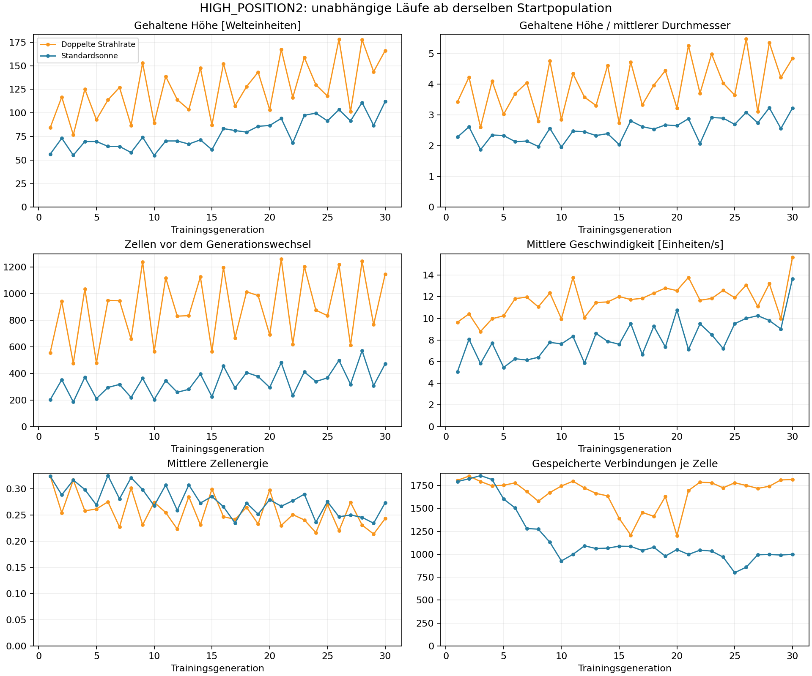
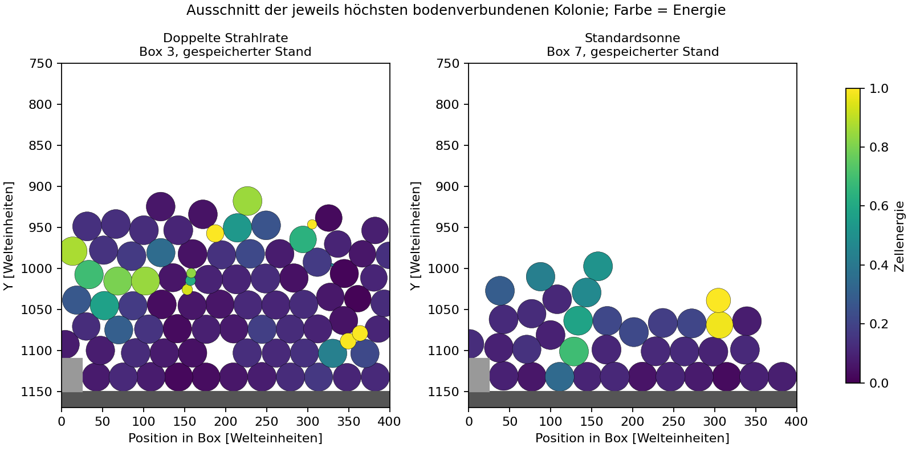
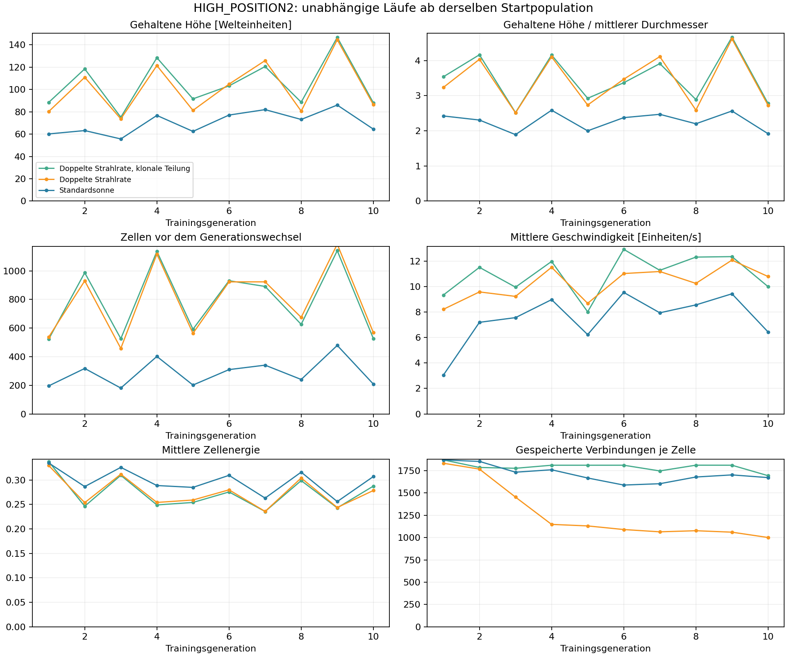
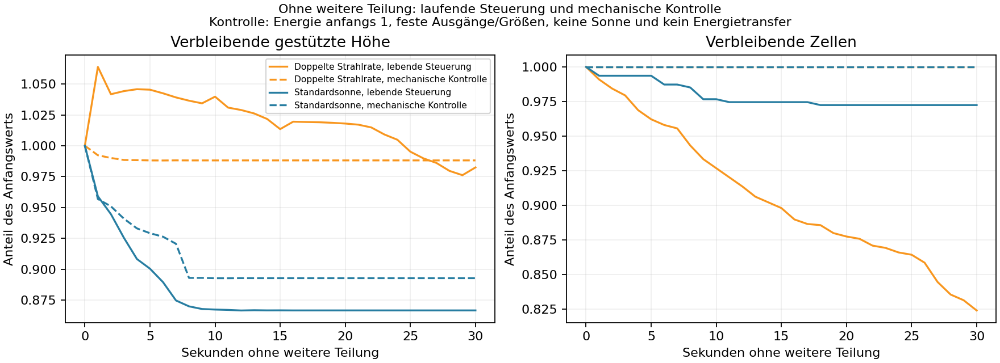

# HIGH_POSITION2: ausgefuehrte Evolutionslaeufe

15. Oktober 2026. Es wurden echte Netze, Zellteilungen, Mutationen, Sonne,
Energietransfer und Physik ausgefuehrt. Keine vorgeschriebenen Strukturen oder
zusaetzlichen Energiegeschenke waehrend der Entwicklung. Der normale Trainingswechsel
erzeugt weiterhin 16 frische, voll versorgte Gruenderzellen.

## Ergebnis

Die neue Auswahl findet hoehere, zusammenhaengende Verbaende. In diesen Laeufen
entstehen aber **breite mehrschichtige Matten, keine schlanken aufrechten Tuerme**.
Mehr Sonne erhoeht vor allem die Zahl der Teilungen und die Bevoelkerungsdichte.

Der wichtigste Nachversuch: Wird weitere Teilung unterbunden, behaelt die anfangs
hoechste Box des besten Mehr-Sonnen-Standes nach 30 Sekunden **98,2 % ihrer Hoehe**.
Die mittlere Geschwindigkeit sinkt von 13,09 auf 2,16 Welteinheiten/s. Bei fixierten
Ausgaengen und kontrollierter Energieversorgung bleiben 98,8 % der Hoehe erhalten;
der Verband kommt praktisch vollstaendig zur Ruhe.

Damit ist die Physik fuer die entstandenen Verbaende tragfaehig. Laufende Teilung,
Wachstum, Steuerung und Zellverluste tragen zur beobachteten Unruhe bei. Der
Nachversuch trennt diese einzelnen Ursachen noch nicht vollstaendig voneinander.

## Umfang und Bedingungen

- Pilot: Standardsonne, doppelte Strahlrate und doppelte Strahlrate mit klonaler
  natuerlicher Teilung, jeweils zehn Trainingsgenerationen.
- Laengere Laeufe: Standardsonne und doppelte Strahlrate, jeweils 30 Generationen.
- Insgesamt **90 Trainingsgenerationen, 270.000 Physikschritte, 75 Minuten
  aufsummierte Simulationszeit**. Die einzelnen langen Laeufe dauern jeweils
  25 Simulationsminuten. Dazu vier Nachversuche zu je 30 Simulationssekunden.
- Alle fuenf Laeufe beginnen mit derselben gespeicherten Population: 16 zufaellige
  Genome und fest vorgegebene initiale Koerperfarben, Welt 6400 x 1200.
- 60 Hz, vier Common-Pool-Worker, Strahlabstand 60, Energie pro Strahl 0,005.
  Strahlrate 10 bzw. 20. Globale Mutation 0,1 / Staerke 0,2. Natuerlicher
  Teilungsmultiplikator 1, nur beim klonalen Pilotversuch 0. Eingabeskalierung aus.
- Aktuelle Physik: Anziehung maximal 90, Kontakt 125, Viskositaet 0,8,
  Rotationsdaempfung 0,8/s, Kontaktzone 0,25. Keine Physikparameter optimiert.
- Alle Laeufe abgeschlossen, kein Aussterben, keine nichtendlichen Zustandswerte,
  kein Erreichen des Abbruchlimits von 4096 Zellen. Groesste sekundenweise
  erfasste Population der langen Laeufe: 571 bzw. 1260 Zellen.

Genom-, Sonnen-, Elternauswahl- und Farbmutation-Zufallsquellen wurden gesetzt.
Die Metamutation der Mutationsfaktoren verwendet weiterhin eigene, ungesetzte
Zufallsquellen. **Die Startpopulation ist exakt gespeichert; ganze Verlaeufe sind
nicht bitgenau reproduzierbar.** Pilot und lange Laeufe sind deshalb separate
Realisierungen und keine Fortsetzungen derselben Zufallsfolge.

## Hoehenentwicklung und Population

Die Hoehe ist die Fitnesshoehe: zeitlich gehaltene mittlere Oberkantenhoehe des
oberen Verbandsviertels. Sie ist nicht mit der hoechsten einzelnen Zelloberkante
gleichzusetzen. In den langen Laeufen wird die Fitness der tatsaechlichen Elternkandidaten
protokolliert. Der Pilot erfasst noch das Maximum der Historien aller lebenden Zellen.
Die Pilotwerte dienen deshalb nur der ersten Orientierung.

Generationen dauern 50, der Sonnenzyklus 120 Simulationssekunden. Nach zwoelf
Generationen wiederholt sich ihre zeitliche Ausrichtung. Fuer die folgenden
Medianwerte werden die ersten bzw. letzten zwoelf Generationen verwendet; so ist
jede Lichtphase gleich oft enthalten.

| Messwert | Standardsonne | Doppelte Strahlrate |
| --- | ---: | ---: |
| Gehaltene Hoehe, erste 12 Generationen | 67,1 | 113,9 |
| Gehaltene Hoehe, letzte 12 Generationen | 92,8 | 143,5 |
| Hoehe / mittlerer Zelldurchmesser, letzte 12 | 2,81 | 4,33 |
| Zellzahl vor Auswahl, letzte 12 | 371,5 | 930 |
| Mittlere Energie, letzte 12 | 0,259 | 0,236 |
| Mittlere Geschwindigkeit, letzte 12 | 9,50 | 12,58 |
| Beste gehaltene Hoehe des gesamten Laufs | 112,2 (Generation 30) | 178,2 (Generation 26) |
| Biologische Teilungen ueber 30 Generationen | 14.730 | 30.859 |
| Biologische Todesfaelle ueber 30 Generationen | 5.170 | 4.699 |

Training entfernt beim Generationswechsel die bisherige Population. Diese ersetzten
Zellen werden nicht als biologische Todesfaelle mitgezaehlt. Rohwerte sind in den
CSV-Dateien dokumentiert; die Mediane sind keine Mittelwerte unabhängiger Replikate.



Die Hoehenzunahme besteht auch relativ zur Zellgroesse, ist also nicht ausschliesslich
ein Groesseneffekt. Bei Standardsonne sinkt zugleich die mittlere gespeicherte
Verbindungszahl (Median erster/letzter zwoelf Generationen: 1393 -> 996); bei mehr
Sonne bleibt sie bei etwa 1745. Das zeigt unterschiedliche Suchverlaeufe, beweist
aber keine funktionelle Differenzierung der Zellen.

Die Endpopulation schwankt stark mit dem Lichtangebot. Im Standardlauf betraegt
die Korrelation zwischen angebotener Sonnenenergie waehrend einer Generation und
ihrer Endpopulation etwa 0,79. Das ist eine Beschreibung dieses einen Verlaufs,
kein isolierter Nachweis einer Ursache oder ein statistischer Wirksamkeitsvergleich.



Die Abbildungen verwenden dieselben Raumachsen; die Farbe zeigt Zellenergie.
Der Unterschied zwischen mehr Biomasse und einer schlanken tragenden Struktur
ist hier deutlich sichtbar. Die Geschwindigkeit allein beweist keine Instabilitaet:
Bewegung eines ganzen Verbandes ist erlaubt. Deshalb wurden die folgenden
Nachversuche und eine um starre Bewegung bereinigte Formmetrik ergaenzt.

## Klonaler Pilotversuch

Bei doppelter Strahlrate betraegt die mediane gehaltene Hoehe der letzten fuenf
Pilotgenerationen 104,7, mit klonaler Teilung 103,2 Welteinheiten. Die entsprechenden
Zellzahlen liegen bei 923 bzw. 891. Ein offensichtlicher frueher Vorteil der klonalen
Entwicklung ist in diesen zehn Generationen nicht erkennbar. Das ist **kein belastbares
Urteil gegen klonale Entwicklung**: wenige Generationen, ein Initialgenom-Pool,
stochastische Metamutation und noch kein passendes spezialisiertes Entwicklungsprogramm.



## Nachversuche an den besten gespeicherten Staenden

Beide Kontrollbedingungen starten erneut vom jeweiligen gespeicherten Zellstand,
ohne Trainingsselektion. Verfolgt wird die anfangs hoechste Box, nicht bei jeder
Messung eine andere Box. Sonnenphase wird aus der gespeicherten Generationsnummer
rekonstruiert; der anschliessende Strahlenzufall wird neu gesetzt.
Hier wird die momentane gestuetzte Hoehe verfolgt, nicht der zeitliche Fitnesswert:
208,5 Welteinheiten bei mehr Sonne bzw. 131,5 bei Standardsonne zu Beginn.

1. **Keine weitere Teilung:** Nur die Teilungs-Altersschwelle wird unerreichbar hoch
   gesetzt. Gehirne, Wachstum, Sonne, Energietransfer und Sterben laufen weiter.
2. **Mechanische Kontrolle:** Ebenfalls keine Teilung, dazu eingefrorene neuronale
   Ausgaenge und Groessen, Sonne und Energietransfer aus. Jede Zelle erhaelt zu Beginn
   Energie 1, die Netzkosten entfallen, der Grundumsatz bleibt. Auch kleine Neugeborene
   werden in ihrer momentanen Groesse gehalten. Diese Energievereinheitlichung gilt
   ausschliesslich fuer diesen deklarierten Kontrollversuch, nicht fuer das Training.

Ergebnis nach 30 Sekunden:

| Stand / Nachversuch | Hoehe erhalten | Zellen weltweit erhalten | Formabweichung / R |
| --- | ---: | ---: | ---: |
| Standard, keine Teilung | 86,7 % | 97,2 % | 0,98 |
| Standard, mechanische Kontrolle | 89,3 % | 100 % | 0,80 |
| Mehr Sonne, keine Teilung | 98,2 % | 82,4 % | 1,73 |
| Mehr Sonne, mechanische Kontrolle | 98,8 % | 100 % | 0,40 |

Die Formabweichung ist die RMS-Positionsaenderung der ueberlebenden Zellen der
anfangs hoechsten Box nach optimaler gemeinsamer Verschiebung und Drehung, geteilt
durch ihren mittleren Anfangsradius. Tote Zellen fehlen in dieser Metrik; ihr Anteil
wird separat protokolliert. Bei mehr Sonne ueberleben in dieser Box ohne Teilung
86,0 % der urspruenglichen Mitglieder. Hohe erhaltene Hoehe bedeutet hier also
ausdruecklich nicht, dass dieselbe Form und dieselben Zellen unveraendert bleiben.

Die mechanische Kontrolle erreicht bei beiden Staenden mittlere Geschwindigkeiten
von etwa 0,000003 Einheiten/s. Ihre Verbaende koennen sich setzen und dann ruhen.
Da mehrere Bedingungen gemeinsam fixiert wurden, laesst der Vergleich nicht
eindeutig zwischen neuronaler Steuerung, Energietransfer, Sterben und Wachstum trennen.



## Bewertung und naechster sinnvoller Schritt

- Fuer die entstandenen Matten ist keine generelle Erhoehung der Physikkraefte
  begruendet. Sie koennen bereits getragen werden und zur Ruhe kommen.
- Mehr Sonne liefert in diesen Versuchen mehr Teilungen und mehr Hoehe, aber auch
  mehr laufenden Umbau. Sie erzeugt nicht automatisch die gewuenschte Organisation.
- HIGH_POSITION2 belohnt derzeit Hoehe und Bodenbindung. Auch eine breite, sich
  umordnende Matte erfuellt dieses Ziel. Schlankheit, Formtreue und eine versorgte,
  teilungsarme Basis erhalten noch keinen eigenen Vorteil.
- Als naechste Untersuchung bietet sich eine getrennte Messung von Teilungsorten,
  lokalen Kraeften und Energieversorgung der Basis an. Anschliessend kann die
  Fitness um Formtreue bei erlaubter Gesamtbewegung und die Nutzung der Grundflaeche
  erweitert werden. Die Evolution sollte eine geregelte Teilung selbst entwickeln;
  der kuenstliche Teilungsstopp oben ist ein Diagnoseversuch.

Es gibt keine Vergleichslaeufe mit der alten HIGH_POSITION2-Auswahl und keine
statistische Serie unabhaengiger Initialpopulationen. Ein Erfolg der neuen Auswahl
gegenueber der alten oder die allgemeine Evolution von Organismen ist damit nicht
nachgewiesen. Die beschriebenen Lernfortschritte beziehen sich auf diese Laeufe.

## Daten, Zellstaende und Wiederholung

Kleine Rohdaten und Grafiken sind versioniert unter `docs/evolution/pilot/` und
`docs/evolution/long/`. Die grossen `.cells`-Dateien bleiben ausserhalb der Versionsverwaltung
unter `experiments/high-position2-2026-10-15/`; dieser Ordner wird von `mvn clean` nicht entfernt.

- [Beste Population mit mehr Sonne](experiments/high-position2-2026-10-15/more-sun-best.cells).
- [Beste Population mit Standardsonne](experiments/high-position2-2026-10-15/standard-best.cells).
- [Gemeinsame Startpopulation](experiments/high-position2-2026-10-15/initial.cells).
- `more-sun-founders-generation30.cells` und `standard-founders-generation30.cells`
  enthalten die zuletzt ausgewaehlten frischen Gruender fuer weitere Entwicklung.

Zum visuellen Vergleichen HIGH_POSITION2 pausiert starten und mit **Load** eine
Population ersetzen. Fuer den Mehr-Sonnen-Stand gehoeren Strahlrate 20 und Energie
pro Strahl 0,005 zu den Versuchsbedingungen. Ein Laden stellt die Population wieder
her, nicht alle Zufallsquellen und transienten Taktphasen des gesamten Versuchs.

`HighPosition2EvolutionStudyTest` ist explizit optional. Ein unbeabsichtigter normaler
Testlauf startet keine langen Simulationen. Der Beobachter sitzt vor dem Austausch
der Trainingspopulation und veraendert deren Bewertung nicht. Die einfachen
Dateifunktionen verwenden jetzt gepufferte Streams fuer grosse Zellstaende.

```powershell
mvn test '-Dtest=HighPosition2EvolutionStudyTest' '-Devolution.study=true' '-Devolution.generations=30' '-Devolution.cases=standard,more_sun' '-Devolution.output=target/evolution' '-Devolution.max_wall_seconds=900' '-DargLine=-Xmx3g -Djava.util.concurrent.ForkJoinPool.common.parallelism=4'
mvn test '-Dtest=EvolutionArtifactExportTest' '-Devolution.artifacts=target/evolution' '-Devolution.followup=true' '-DargLine=-Xmx3g -Djava.util.concurrent.ForkJoinPool.common.parallelism=4'
python scripts/analyze_evolution.py target/evolution target/evolution/analysis
```

Der letzte gezielte Lauf bestand mit 63 regulaeren Trainings-/Datei-/Vererbungspruefungen
plus der Nachversuchs-/Exportpruefung: **64 Faelle erfolgreich**.
