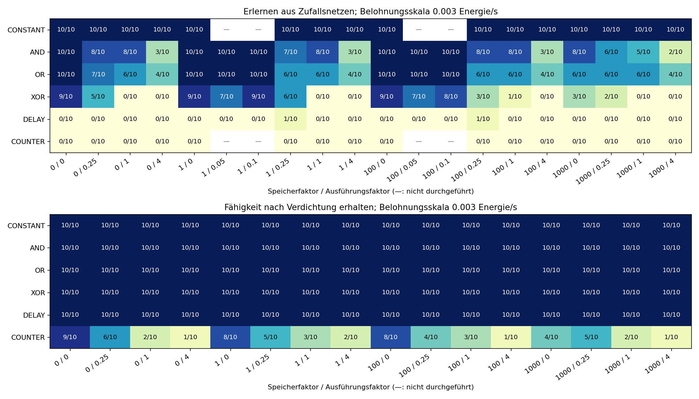
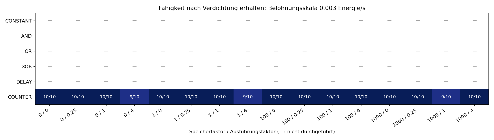

# Gehirnkosten: Ergebnisse der Kalibrierung

Abgeschlossen am 15.10.2026: **2478 Läufe**, je 32 Kandidaten, 600–2000
Generationen je Lauf. Zusammen 2.186.800 Generationen über alle Läufe.
Kein Kandidat musste wegen der Größen-/Endlichkeitsgrenzen abgewiesen werden.
[Versuchsaufbau und Erfolgskriterien](GEHIRN_KALIBRIERUNG.md).

| Serie | Läufe |
|---|---:|
| Pilot ohne Kosten | 18 |
| Erwerb: 16 Preise × sechs Aufgaben × zehn Seeds | 960 |
| Verdichtung: gleiches Preisraster | 960 |
| Vier verfeinerte Preise × vier Aufgaben × zehn Seeds | 160 |
| Zähler-Verdichtung mit breiteren Trainingsfolgen | 160 |
| Gedächtniserwerb ohne Kosten, 2000 Generationen | 20 |
| Zehnfach geringere Belohnung bei Verdichtung | 80 |
| Wettbewerb gegen statische Netze, mit/ohne Zusatzstruktur | 120 |

## Entdecken und Behalten sind verschieden

Erwerb, 1200 Generationen, Belohnungsskala 0,003. Erfolgreiche Endnetze je zehn Starts:

| Speicher-/Arbeitsfaktor | AND | OR | XOR | Synapsen erfolgreicher XOR-Netze, Median |
|---|---:|---:|---:|---:|
| 0 / 0 | 10 | 10 | 9 | 68 |
| 1 / 1, bisherige Koeffizienten | 8 | 6 | 0 | keine Lösung |
| 100 / 0 | 10 | 10 | 9 | 7,5 |
| 1 / 0,1 | 10 | 10 | 9 | 7 |
| 100 / 0,1 | 10 | 10 | 8 | 8 |

Die explizite XOR-Lösung braucht nur sechs Synapsen. Bei Verdichtung bleibt
ihre Fähigkeit unter allen 16 Preisen in 10/10 Starts erhalten. Beim Erwerb
mit den bisherigen Arbeitskosten wird dagegen regelmäßig die billige konstante
Ausgabe 0,5 ausgewählt. Das passt zu einer Lernbarriere: Zwischenformen kosten
bereits Arbeit, bevor sie genug Zusatznutzen liefern. Es ist keine Grenze der
Darstellbarkeit von XOR.

Sehr hoher Speicherunterhalt hilft ebenfalls nicht pauschal: Faktor 1000 ohne
Arbeitskosten erreicht nur 3/10 erfolgreiche XOR-Endnetze. Faktor 100 ist hier
verträglicher. Unterschiede von 8/10 gegen 9/10 rechtfertigen bei zehn Starts
noch keine Rangfolge optimaler Parameter; das Raster ist explorativ.

Die Raster haben verschiedene Anfangspools und Budgets (1200 bzw. 600 Generationen).
Sie beantworten verschiedene Fragen. Gedankenstrich: Kombination nicht durchgeführt.

## Gedächtnis: Suche und Trainingsabdeckung

DELAY und COUNTER erreichen im ursprünglichen Erwerbsbudget ohne Kosten jeweils
0/10 erfolgreiche Endnetze. Mit 2000 Generationen und vier Trainingsfolgen à
64 Entscheidungen erreicht DELAY 1/10, COUNTER weiterhin 0/10. Ein DELAY-Lauf
erreicht zwar etwa 95 % Genauigkeit, erfüllt aber das MSE-Kriterium nicht.
Die expliziten Kontrollen lösen beide Aufgaben. Energiekosten allein erklären
diese Entdeckungsprobleme nicht; Suche, Mutation, Layer-Taktung, Aufgabenbudget
und Trainingsabdeckung müssen dafür getrennt untersucht werden. Zufällige
Eingaben je Denkaufruf bilden nicht die gesamte zeitliche Verteilung biologischer
Sensoren nach.

Bei Zähler-Verdichtung mit bisherigen Preisen bleiben zunächst nur 3/10 Endnetze
zuverlässig. Training: zwei Folgen à 24 Schritte; Prüfung: acht à 64. Mit vier
Trainingsfolgen à 64 steigt die Quote bei unveränderten Preisen auf **10/10**.
Auch die übrigen Preise erhalten dann 9–10/10 zuverlässige Zähler.

Die Probe ändert Länge und Anzahl der Trainingsfolgen gleichzeitig. Sie isoliert
nicht deren Einzelbeiträge, widerlegt aber die vorschnelle Schlussfolgerung,
der Zählerverlust müsse allein an den Gebühren liegen. Kostendruck fördert auch
billige Näherungen mit Fehlern in längeren oder anderen Situationen. Für NONE
sind entsprechend lange Prüfungen und wechselnde Ressourcen wichtig.

## Funktion muss ihre Kosten bezahlen

Im Wettbewerb beginnen sieben von 32 Kandidaten als billige statische Netze.
Die anderen erhalten ein funktionierendes Gedächtnisprogramm. Bei hoher
Belohnung (Skala 0,003) bleiben DELAY und COUNTER bei den Preisen 1/1 und
100/0,1 in 10/10 Starts erhalten.

Bei hundertfach geringerem Ertrag (Skala 0,00003) gewinnt gegen den Zähler in
allen Starts die statische Steuerung, auch ohne unnötigen Zusatzlayer im Startnetz.
Die günstigere verzögerte Kopie bleibt bei kompaktem Start in 10/10 Starts erhalten.
Das Modell begünstigt also nicht zwangsläufig Netze ohne Gedächtnis: Funktioneller
Mehrwert muss die Kosten decken.

Auch der Weg zur günstigen Lösung zählt: Bei geringem Ertrag und Preis 1/1
überlebt DELAY mit Zusatzlayer nur 1/10 Starts, ohne Zusatzlayer 10/10. Mit
Preis 100/0,1 überleben beide Varianten 10/10. Verdichtung ohne statische
Konkurrenz kann solche wirtschaftlichen Ausschlussprozesse unterschätzen.

## Laufzeit ist nicht gleich Synapsenzahl

Nach Ende der Trainingsjobs wurden **430 serialisierte Endnetze** separat
gemessen: zunächst alle aufwärmen, dann drei Wiederholungen in wechselnder
Reihenfolge, je mindestens 20.000 Entscheidungen. Verhalten und Synapsenzahl
wurden nach dem Laden gegen die Experimentdaten geprüft. In den Messfenstern
liefen 26.030.400 Entscheidungen.

Zeiten enthalten Eingabeschreiben, Vorwärtsrechnung, Ausgabeerzeugung und Reset
zwischen Fragen/Folgen; keine Mutation oder Fitnessbuchhaltung. Es zählen nur
Seed-Paare, in denen beide Netze die Aufgabe lösen:

| Vergleich gegen ohne Kostendruck | Erfolgreiche Paare | Median der Beschleunigung |
|---|---:|---:|
| Erworbene XOR-Netze, Preis 100/0 | 9 | 1,58× |
| Erworbene XOR-Netze, Preis 100/0,1 | 7 | 7,29× |
| Erworbene AND-Netze, Preis 100/0,1 | 10 | **0,94×**, etwas langsamer |
| Verdichtete DELAY-Netze, Preis 1/1 | 10 | 2,49× |
| Verdichtete robuste Zähler, Preis 1/1 | 10 | 1,47× |

Nahezu unverbundene Neuronen und Layer können weiterhin Zeit kosten. Eine
Synapsengebühr bildet das nicht vollständig ab. Eine deterministische Gebühr
für aktive Neuronen/Ports bleibt ein sinnvoller weiterer Versuch, ist hier
noch nicht kalibriert. Äußere Aktivierungszahlen werden protokolliert;
Modulinneres ist darin nicht enthalten. Kurze Messungen auf einem Rechner
garantieren keine proportionale Beschleunigung einer vollständigen Zellwelt.

## Ableitung für NONE

**Alle Gebühren pauschal zu erhöhen ist durch diese Daten nicht begründet.**
Ein sinnvoller nächster Weltvergleich:

1. Bisherig: Speicher 1, Arbeit 1.
2. Weniger Arbeitsdruck: Speicher 1, Arbeit 0,1.
3. Mehr Unterhalt bei weniger Arbeitsdruck: Speicher 100, Arbeit 0,1.

Variante 3 entspräche `3e-8` je gespeicherter Synapse und Sekunde sowie `2e-9`
je ausgeführter Synapse und Denkaufruf. Für den zuvor untersuchten HIGH_POSITION3-
Stand wären das bei gleicher Aktivität zusammen etwa 2,5 % statt 17,3 % des
Grundverbrauchs: ungenutzte Struktur teurer, laufende Berechnung insgesamt
leichter finanzierbar. Das ist ein **NONE-Vergleichskandidat, kein neuer Standard**.

Die Mininetze haben zwei Eingänge, einen Ausgang und keine festen Zellzustandslayer.
Echte Zellen haben viel mehr Ein-/Ausgaben, Körperkosten, Sonnenrauschen,
Energieübertragung und Fortpflanzung. Die exakte Auswahl nach mittlerem Nutzen
erkennt auch sehr kleine Preisunterschiede; in Ressourcenwelten können diese im
stochastischen Ertrag untergehen. Ein großer NONE-Lauf wurde hier nicht ausgeführt.
Dafür gleiche Startpopulationen und vergleichbare äußere Energiezufuhr sowie
mehrere Wiederholungen verwenden; Aufwand, Nettoenergie, Fortpflanzung und
Funktionsverlust mitmessen. Eine Ursache der bisherigen NONE-Beobachtungen ist
mit diesen Miniversuchen nicht nachgewiesen.

## Daten und Prüfungen

Ergebniszeilen, Einstellungen und komprimierte Generationenverläufe stehen unter
`docs/brain-calibration/`, Zusammenfassungen unter `analysis/` und den benannten
Folgeanalysen. `trajectory.csv.gz` lässt sich mit gzip/Archivwerkzeugen entpacken.
Unterschiedliche Episoden-/Generationsbudgets werden nicht zusammengemischt.

Alle 2478 Endnetze bleiben lokal unter `experiments/brain-calibration-2026-10-15/`
erhalten, die unkomprimierten Haupt-/Folgeverläufe daneben. Der Pilotverlauf steht
unter `docs/brain-calibration/pilot/`. `.nn` sind serialisierte Netzobjekte,
keine über die Zelloberfläche ladbaren `.cells`-Dateien.

**384 gezielte Routineprüfungen bestanden.** Alle zehn optionalen Evolutionsserien
und die separate Laufzeitprüfung sind abgeschlossen. Produktionslogik und
Energiekonstanten bleiben unverändert.
