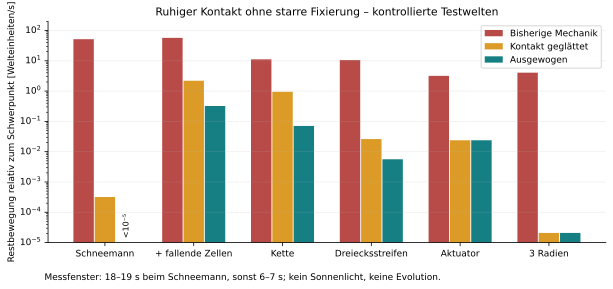
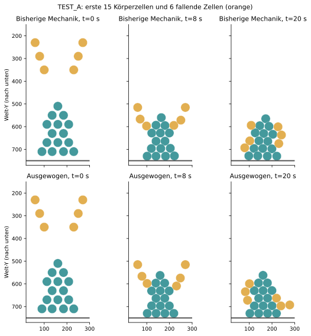
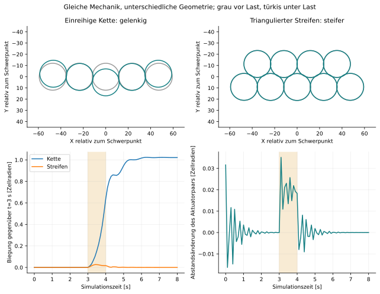
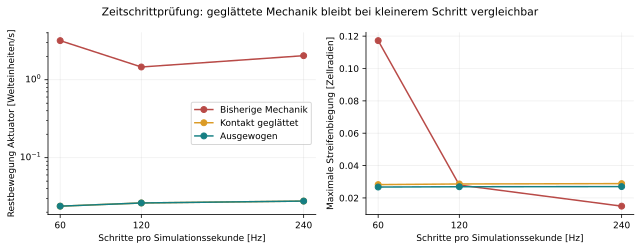

# Mechaniklabor: Schneemann, Gelenkigkeit und Stabilität

## Ergebnis

Der Schneemann ist die erste große Anziehungsgruppe in `TEST_A`: 15 Körperzellen
mit sechs zusätzlich von oben fallenden Zellen. Die Instabilität war nicht nur eine
ungünstige Anziehungsstärke. Die alte Aktorkraft hatte am Kontaktpunkt einen
Richtungssprung: Für einen beliebig kleinen Abstand blieb ihr Betrag fast maximal;
beim Überschreiten des anderen Aktors wechselte die Richtung. Selbst ein isoliertes
Zellpaar zitterte deshalb dauerhaft. Mehr Anziehung verstärkte dieses Problem.

Eine endliche lineare Kontaktzone beseitigt den Sprung. Zusammen mit stärkerer
Rotationsdämpfung ergibt sich ein brauchbarer **Startbereich** für stabile, bewegliche
Verbände. Das ist kein universelles Optimum für beliebige Organismen.



| Parameter | LEGACY | BALANCED |
| --- | ---: | ---: |
| Maximale Anziehungsstärke | 90 | 90 |
| Zellkontakt-Steifigkeit | 125 | 125 |
| Viskosität | 0,8 | 0,8 |
| Rotationsdämpfung, 1/s | 0,8 | 3,0 |
| Lineare Kontaktzone / Aktorfeldradius | 0 | 0,25 |

`MechanicsPreset.BALANCED.apply(config)` setzt diese Werte. `TEST_A` verwendet das
Preset beim Erzeugen seiner Umgebung. Allgemein ist die Kontaktzone 0,25 jetzt
ebenfalls Standard; die allgemeine Rotationsdämpfung bleibt bei 0,8.
`MechanicsPreset.LEGACY.apply(config)` erlaubt den Vergleich mit der früheren Kraftform.
Andere Modi werden nicht automatisch auf BALANCED umgestellt. Die Konfiguration
bleibt ein Singleton: Explizite Preset-Wechsel gelten für nachfolgende Berechnungen.

### Messwerte bei 60 Hz

Restbewegung ist der mittlere RMS-Betrag der Zellgeschwindigkeiten relativ zum
Schwerpunkt im späten Messfenster. Gemeinsame Translation zählt nicht als Zittern.

| Aufbau | LEGACY, Einheiten/s | BALANCED, Einheiten/s | Beobachtung |
| --- | ---: | ---: | --- |
| Schneemann ohne Einschläge | 51,607 | <0,00001 | Zusammenhängend, gesetzte Höhe 86,4 % des Ausgangswerts |
| Schneemann mit Einschlägen | 57,059 | 0,321 | Rund 178-fache Reduktion; Körper zusammenhängend |
| Einreihige Kette | 11,155 | 0,071 | Biegsam, keine verlorenen ursprünglichen Nachbarschaften |
| Triangulierter Streifen | 10,543 | 0,0056 | Steifer, Rückkehr nach Entlastung |
| Aktuatorpaar | 3,176 | 0,0239 | Kleiner reversibler Hub |
| Drei unterschiedliche Radien | 4,060 | 0,000021 | Vorgegebene Größen bleiben erhalten |

Der Schneemann setzt sich unter Schwerkraft und Anziehung; seine Ausgangsform wird
nicht künstlich fixiert. Minimal bleiben rund 84,6 % seiner ursprünglichen geometrischen
Nachbarschaften erhalten. Die sechs fallenden Zellen wirken mechanisch vollständig mit,
werden aber nicht in die Körpermetriken aufgenommen.



## Kraftform und Parameterstudie

Sei `d` der Aktorabstand, `R` die Reichweite des Senders, `s` seine vorzeichenbehaftete
Stärke und `epsilon = 0.25 * R`. Innerhalb der Reichweite gilt für seinen Kraftbeitrag:

```text
F = -s * Größenskalierung * (1 - d/R) * Richtungsvektor / max(d, epsilon)
```

Der nicht normierte Richtungsvektor zeigt zum anderen Aktor. Außerhalb der Kontaktzone
bleibt die vorherige Kraft erhalten; innerhalb geht ihr Betrag kontinuierlich auf null.
Empfangener Feldbeitrag und Reaktion verwenden jeweils die Reichweite ihres Senders.
Die Gegenkräfte bleiben gleich groß und entgegengesetzt. Anziehung bleibt negativ,
Abstoßung positiv. Bei exakt deckungsgleichen Aktoren wird keine Richtung erfunden;
die separate Zellabstoßung trennt überlagerte Zellkörper.

Untersucht wurden Anziehungsstärken 30/90/180, Kontaktsteifigkeiten 80/125/250,
Viskositäten 0,8/2, Kontaktzonen 0/0,1/0,25/0,5 und Rotationsdämpfungen 0,8/3.
Größere Viskosität bremst auch die gemeinsame Bewegung. Stärkere Anziehung verformt
den Verband mehr; hohe Kontaktsteifigkeit allein beseitigt das Kontaktzittern nicht.
Die Zone 0,25 erlaubt hier mehr Aktuatorhub als 0,1, ohne den Verband aufzulösen.

## Beweglichkeit und Rückstellung



Kette und Dreiecksstreifen verwenden dieselben Kraftparameter und Zellradien.
Zwischen Sekunde 3 und 4 wirkt auf die mittlere Zelle eine Querlast von 6; die beiden
Endzellen erhalten jeweils -3. Die Lastsumme ist null. Die Biegung wird gegenüber
der Verbindungslinie der Endzellen gemessen.

- Kette: maximale Biegung **1,024 Zellradien**, Restbiegung nach Entlastung **1,022**.
- Streifen: maximale Biegung **0,02675 Zellradien**, Restbiegung **0,000067**.
- Der Streifen biegt sich damit rund **38-mal weniger**. Die Kette bleibt gelenkig,
  besitzt aber kein Gedächtnis für einen Ruhewinkel und richtet sich nicht selbst gerade.

Beim Aktuatorpaar wird die Anziehung eine Sekunde lang von 100 % auf 35 % reduziert
und anschließend wiederhergestellt. Maximaler Hub: **0,03757 Radien**, etwa **0,45
Welteinheiten** bei Radius 12. Das enthält ein Einschwingmaximum; am Ende der Haltephase
beträgt die Abstandsänderung etwa 0,22 Einheiten. Resthub nach Rückkehr: **0,0000096 Radien**.
Das ist eine kleine reversible Aktuation, kein Nachweis eines kräftigen Muskels.

Eine Sekunde vor Ende erhalten alle Körperzellen denselben Geschwindigkeitsimpuls
von 10 in X-Richtung. Ohne Einschläge folgt eine Verschiebung von rund **2,39
Welteinheiten**. Ruhige Kontakte bedeuten keine Fixierung an der Welt. Der äußere
Impuls prüft Beweglichkeit, keine autonome Fortbewegung.

## Zeitschrittprüfung und Aussagegrenzen



Alle sechs Aufbauten wurden für LEGACY, reine Glättung und BALANCED bei 60/120/240 Hz
verglichen. Die maximale Streifenbiegung beträgt **0,02675 / 0,02692 / 0,02703 Radien**;
die endgültige Form bleibt nahezu gleich. Der Aktuatorhub beträgt **0,03757 / 0,03666 /
0,03676 Radien**. Beim Schneemann ohne Einschläge ist die gesetzte Form nahezu identisch.
Kollisionen bleiben empfindlicher: Mit fallenden Zellen liegt die Restbewegung bei
**0,32 / 0,44 / 0,39 Einheiten/s**. Nicht jede Kollisionsbahn ist zeitschrittunabhängig.

Die Studie umfasst **318 deterministische Weltläufe**, keine statistische Evolutionsstudie.
Feste Geometrien und Gehirnausgaben, keine Geburt, Mutation, Sonnenenergie oder Reparatur.
Außer bei Schneemann und Größenstapel wird die Schwerkraft durch eine gleich große
äußere Gegenkraft aufgehoben. Messfenster: Sekunde 18–19 beim Schneemann, sonst 6–7.
Die Körpermetrik richtet die Ausgangs- und Endpositionen starr aus: Gemeinsame Verschiebung
oder Rotation ist keine Verformung. Biegewerte sind mit Radius 12, Schneemann-Formfehler
mit Radius 20 normiert. Der Größenstapel verwendet ebenfalls Radius 20 als Bezugsmaß.

Kontaktgrafen sind geometrische Nähebeziehungen, keine persistenten Bindungen.
Überlappung bedeutet `(r1+r2-d)/(r1+r2)`; sie erreicht beim ausgewogenen Schneemann
vorübergehend etwa 10 %, bei Streifen/Kette etwa 3 %. Harte Nichtdurchdringung zwischen
Zellen und kontinuierliche Hinderniskollisionen sind weiterhin nicht implementiert.
Große Zeitschritte, andere Größen oder wesentlich stärkere Kräfte benötigen neue Prüfungen.

## Vom Verband zum differenzierten Organismus

Die Tests zeigen mechanische Möglichkeiten, keine Entstehung aus einer einzelnen Zelle.
Im Code sind dafür weitere, getrennte Einschränkungen erkennbar:

1. **Farben sind keine mechanischen Zelltypen.** Feldkräfte berücksichtigen Größe,
   Rotation und Stärke, aber keine Typ-Affinität. Gehirne können Farben wahrnehmen
   und darauf reagieren; die Kontaktmechanik kennt keine selektive Haftung.
2. **Zellzustand ermöglicht bereits unterschiedliche Programme.** Drei Bits aktivieren
   verschiedene Netzlayer, Eltern bestimmen den Kindzustand. Dasselbe unveränderte
   Genom kann grundsätzlich verschiedene Zellprogramme ausführen; diese Studie
   testet noch keine daraus entstehende Entwicklung.
3. **Mutation erfolgt bei jeder Teilung.** Gemeinsame DNA des Körpers ist nicht geschützt.
   Somatische Teilung ohne Genmutation und eine mutierende Fortpflanzungslinie wären
   ein sinnvoller nächster Vergleich.
4. **Selektion bewertet Einzelzellen.** HIGH_ENERGY bewertet Zellenergie, Höhenstrategien
   Zellposition. Der Nutzen einer Stütz- oder Versorgungsschicht für den ganzen Körper
   wird damit nicht direkt bewertet.
5. **Mechanische Arbeit hat keine eigene Energiebilanz.** Grundumsatz und Gehirnkosten
   werden abgezogen, aktive Kraft- und Größenänderungen nicht anhand ihrer Arbeit.
   Der Aktuatorversuch beweist deshalb keinen energetisch geschlossenen Muskel.

### Nächste mechanische Erweiterung

Ich würde lokale, durch passende Aktoren gebildete **Zellverbindungen** untersuchen:
Ruhelänge, Längssteifigkeit, Biegesteifigkeit, lokale Dämpfung, Bruchgrenze und aktiv
veränderliche Ruhelänge mit Energiekosten. Die Verbindungen müssen aus Zellprogrammen
entstehen und lösbar sein. Globale Kräfte allein sollten nicht sechs Gewebearten ersetzen.

| Entsprechung | Benötigte Eigenschaft | Stand dieses Versuchs |
| --- | --- | --- |
| Gelenk | Zusammenhalt bei geringer Winkelsteifigkeit, eventuell Winkelgrenzen | Biegsame Kette; keine Winkelgrenzen |
| Sehne/Band | Zugsteifigkeit, Biegsamkeit, definierte Rückstellung | Ruheform/-winkel als Bindungseigenschaft fehlen |
| Knochen | Längs- und Biegesteifigkeit | Triangulierter Verband ist deutlich steifer |
| Bindegewebe | Nachgiebigkeit und lokale viskose Dämpfung | Nur globale Viskosität, keine lokalen Materialparameter |
| Haut | Geschlossene kohärente Schicht mit kontrollierter Dehnung | Nicht separat untersucht |
| Muskel | Verkürzung unter Last mit Arbeits- und Energiegrenze | Kleiner reversibler Feldhub; kein Arbeitsmodell |

Für die Evolution würde ich klein anfangen: Ein unverändertes Genom erzeugt zwei
Zustände, etwa Träger und Energieversorger. Zuerst Aufbau, Versorgung und Regeneration
messen, dann Mutation und Konkurrenz hinzufügen. Interessante Matten sollten als eigene
Laborlinien archiviert und ohne Mutation untersucht werden. Das trennt ihre Untersuchung
von ihrer Erhaltung in einer Konkurrenzwelt und vermeidet kostenlose Energie als Rettung.

## Reproduzieren

Die Folgeuntersuchung [GEWEBEPROBEN.md](GEWEBEPROBEN.md) prüft zwei- und dreischichtige
Packungen, Zug, Druck mit seitlicher Störung, eine schmale bewegliche Brücke und drei
aktive Größenzyklen unter Gegenlast. Sie untersucht ausschließlich die mechanischen
Möglichkeiten mit vorgeschriebenen Gehirnausgaben. Mehrschichtige Geometrien reichen
bereits für steife, rückstellende Teile; neue Verbindungsregeln sind dafür keine Voraussetzung.

Normale Regressionen: [TESTWELTEN.md](TESTWELTEN.md). Die Studie läuft nur explizit:

```powershell
# 18 Parameterkombinationen, jeweils sechs Aufbauten:
mvn test '-Dtest=MechanicsSweepTest' '-Dmechanics.sweep=true' '-Dmechanics.softening=0' '-Dmechanics.output=target/mechanics-legacy' '-DargLine=-Djava.util.concurrent.ForkJoinPool.common.parallelism=1'
mvn test '-Dtest=MechanicsSweepTest' '-Dmechanics.sweep=true' '-Dmechanics.softening=0.25' '-Dmechanics.output=target/mechanics-soft-grid' '-DargLine=-Djava.util.concurrent.ForkJoinPool.common.parallelism=1'
# Acht Glättungs-/Dämpfungsvarianten:
mvn test '-Dtest=MechanicsSweepTest' '-Dmechanics.sweep=true' '-Dmechanics.refine=true' '-Dmechanics.output=target/mechanics-refine' '-DargLine=-Djava.util.concurrent.ForkJoinPool.common.parallelism=1'
# Drei Vergleichsprofile bei 60 Hz; danach mit unten angegebenem dt/Verzeichnis wiederholen:
mvn test '-Dtest=MechanicsSweepTest' '-Dmechanics.sweep=true' '-Dmechanics.validation=true' '-Dmechanics.dt=0.016666666666666666' '-Dmechanics.output=target/mechanics-hz60' '-DargLine=-Djava.util.concurrent.ForkJoinPool.common.parallelism=1'
# 120 Hz: dt=0.008333333333333333, Verzeichnis target/mechanics-hz120
# 240 Hz: dt=0.004166666666666667, Verzeichnis target/mechanics-hz240
python tools/plot_mechanics.py --collect
```

Matplotlib wird nur für die Abbildungen benötigt. Die Java-Anwendung und Tests benötigen
es nicht. `python tools/plot_mechanics.py` zeichnet aus den mitgelieferten Messdaten neu,
ohne Simulationen zu starten. Die Grafikdaten wurden visuell geprüft.

- [Messwerte aller Weltläufe](docs/mechanics/results.csv).
- [Positionen der drei Vergleichsprofile bei 60 Hz, alle 100 ms](docs/mechanics/trajectories.csv).
- [MechanicsLab.java](src/test/java/de/lifecircles/service/MechanicsLab.java): Aufbauten, Lasten, Metriken.
- [MechanicsRegressionTest.java](src/test/java/de/lifecircles/service/MechanicsRegressionTest.java): Mindestanforderungen.
- [MechanicsSweepTest.java](src/test/java/de/lifecircles/service/MechanicsSweepTest.java): explizite Studie.

Zwei Aufbaufehler wurden zusätzlich korrigiert: Der Helfer normalisiert den Größen-Ausgang,
statt den Radius als NN-Ausgabe zu verwenden; TEST_A verwendet die tatsächliche Welthöhe.
Der erste Fehler betrifft insbesondere unterschiedliche Radien, nicht den gleich großen
Schneemann. Der zweite betrifft getrennt erzeugte Testwelten; in der bisherigen normalen
TEST_A-Initialisierung stimmten globale und tatsächliche Höhe bereits überein.
