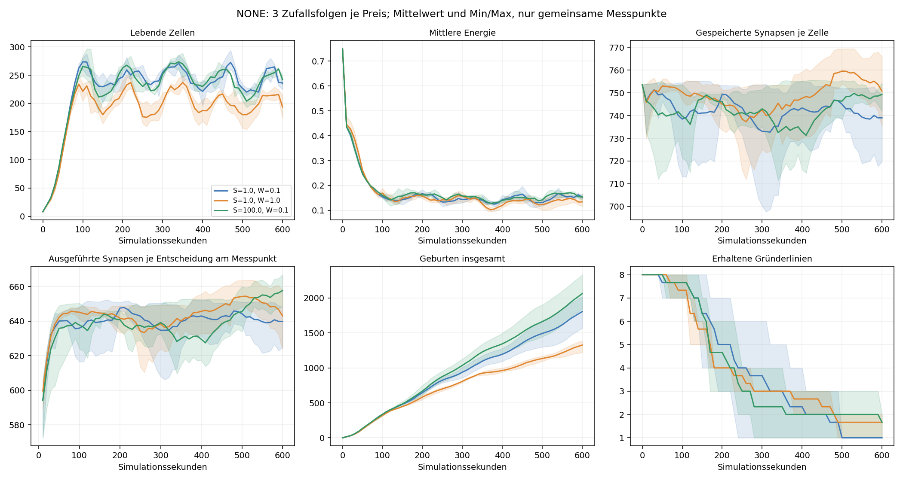
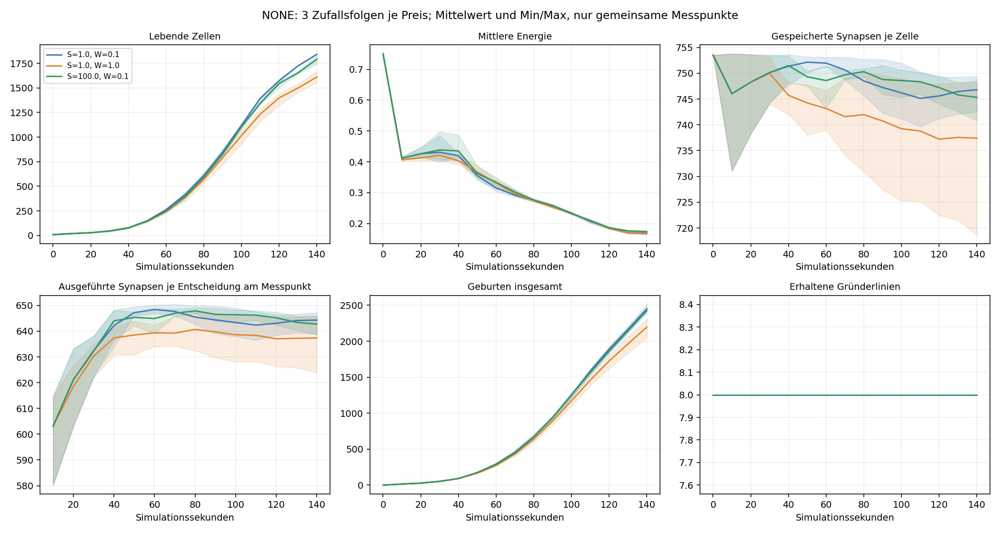

# Gehirnkosten unter NONE: Ergebnisse

Der anschließende Vergleich über je 10.000 Simulationssekunden ist ebenfalls
abgeschlossen: [Langzeitergebnisse](NONE_LANGZEIT_ERGEBNISSE.md).

Abgeschlossen am 16.10.2026: **27 Versuche, insgesamt 424.872 Simulationsschritte**.
Alle drei optionalen Serien sind ohne Testfehler abgeschlossen. Ausgangspunkt war
`test-highPos3-2026-10-15-a01.cells` mit 480 Zellen. Die Quelldatei blieb unverändert;
ihre SHA-256-Prüfsumme wurde nach den Versuchen erneut bestätigt:
`38c7860c26e9c29908666f85ac844417091fccf9c97d6fd8ef0abff8c24dec40`.

Der [Versuchsaufbau](NONE_ENERGIE.md) verwendet echte Sonne, Stoffwechsel,
Energieübertragung, natürliche Teilung, Mutation und Tod. Es gibt keine
Trainingsauswahl, kein Nachfüllen und keine Wiederbesiedlung.

## Vollständiger Ressourcenvergleich

Kleine periodische Welt, 600 × 400 Pixel, Boden, acht gleichmäßig verteilte Gründer
aus den acht ehemaligen Trainingsbereichen. Drei Zufallsfolgen je Preis, identische
Startpopulationen, 36.000 Schritte bei 60 Hz: **600 Simulationssekunden und fünf
Tag-/Nachtzyklen**. Strahlendichte und Energie je Strahl entsprechen den bisherigen
Einstellungen. Alle neun Populationen überlebten das gesamte Zeitfenster.

Mittelwerte über drei Läufe; Klammern zeigen Minimum und Maximum der Endstände:

| Struktur / Berechnung | Lebende Zellen | Energie je Zelle | Synapsen je Netz | Äußere Neuronen je Netz | Geburten insgesamt |
|---|---:|---:|---:|---:|---:|
| 1 / 1, bisher | 193,7 (174–215) | 0,134 | 750,8 (735–766) | 642,4 | 1327 |
| 1 / 0,1 | 236,0 (225–243) | 0,152 | 739,0 (720–749) | 639,5 | 1805 |
| 100 / 0,1 | 242,3 (232–250) | 0,154 | 749,3 (742–754) | 644,2 | 2062 |

Am Start: 753,5 Synapsen und 643,5 äußere Neuronen je Netz, etwa 0,75 Energie je Zelle.



Linien: Mittelwerte, Flächen: Min/Max der drei Läufe, keine Konfidenzintervalle.
Der Ausführungszähler ist nach dem Laden zunächst null; sein erster dargestellter
Wert stammt aus tatsächlich ausgeführten Entscheidungen.

### Weniger Rechenkosten erhöhen Zellzahl und Umsatz

Gegenüber dem bisherigen Preis enden die günstigeren Varianten im Mittel mit
rund **22 % bzw. 25 % mehr Zellen**. Beide haben in jeder der drei gepaarten
Zufallsfolgen mehr lebende Zellen als die bisherige Einstellung. Geburten steigen
im Mittel um rund 36 % bzw. 55 %. Auch Todesfälle nehmen zu: 1141, 1577 und 1828
je Lauf. Eine größere Endpopulation geht hier mit höherem Zellumsatz einher.

Die mittlere Energie je Zelle steigt über die drei Läufe, allerdings nicht in
jeder einzelnen Paarung: Beim dritten Seed liegt sie unter beiden günstigeren
Preisen unter dem bisherigen Preis. Dieser Unterschied ist kein universeller
Energiegewinn für jede einzelne Population.

Die angeforderte Gehirngebühr, gemittelt über alle ausgeführten Zellschritte,
beträgt etwa 0,000773, 0,0000771 und 0,0000990 Energie je Zellsekunde. Das entspricht
25,8 %, 2,6 % und 3,3 % des Grundverbrauchs. Begrenzung bei Energie null ist in
dieser Gebührenstatistik nicht abgezogen. Die höhere Aktivität gegenüber dem
früheren HOLD-Audit erklärt dessen niedrigeren relativen Gebührenanteil.

### Keine starke Verdichtung nachgewiesen

Bei 1/0,1 sind Netze im Endmittel etwa 1,6 % kleiner als unter dem bisherigen
Preis. Die Spannweiten überlappen deutlich; im dritten Seed sind sie sogar größer
als beim bisherigen Preis. Drei Starts liefern keine belastbare Rangfolge für
langfristige Netzverdichtung.

**Der zusätzliche Strukturpreis 100 bringt hier keinen erkennbaren
Verdichtungsvorteil.** Die Endnetze sind in allen drei Seeds größer als unter
1/0,1. Ihre äußere Neuronenzahl liegt sogar leicht über dem Ausgangswert.
Im Verlauf gibt es Abnahmen und anschließendes Wachstum. Einen einzelnen
günstigen Messpunkt als dauerhaften Erfolg zu werten wäre irreführend.

Mittlere Größen ändern sich durch Mutation und durch Verschiebungen zwischen
Gründerlinien. Für die funktionale Bedeutung einzelner Schaltungen wurde kein
separater Gegenversuch durchgeführt. Die Sensornachbarschaften, Zellzustände und
Kraftausgaben sind beschreibende Größen für diese Populationen.

### Mehr Zellen können die Laufzeitgewinne aufbrauchen

Die mittlere gesamte äußere Neuronenzahl am Ende steigt von etwa 124.471 auf
150.917 bzw. 156.130: **rund 21 % bzw. 25 % mehr vorgehaltene Neuronen in der Welt**.
Die kleine Größenabnahme einzelner Netze kompensiert die zusätzliche Zellzahl nicht.
Diese Zählung ist kein CPU-Zeitmodell, zeigt aber den zusätzlichen Aufwand.

Die Serien liefen teilweise gleichzeitig in getrennten JVMs. Schrittzeiten
enthalten Profilierung und Versuchsbuchhaltung und konkurrieren um Rechnerressourcen.
Daraus lässt sich keine belastbare Beschleunigung eines Preises ableiten.
Eine schnellere Gesamtsimulation durch diesen Kosteneingriff ist bisher nicht belegt.

### Vielfalt nimmt rasch ab

Von acht Gründerlinien bleiben bei bisherigen Preisen 1–2, bei 1/0,1 jeweils eine
und bei 100/0,1 jeweils 1–2 übrig. Die Gründerlinien bezeichnen einzelne Startzellen,
keine nachgewiesen unterschiedlichen Genotypen. Die kleine Welt besitzt nur einen
Boden und wenig Raum für getrennte Nischen. Eine Verbesserung langfristiger
Kooperation oder funktionaler Spezialisierung lässt sich daraus nicht ableiten.

## Warum die großen Versuche früh endeten

Die zunächst geplanten großen Welten waren 11.200 × 1.200 Pixel groß und enthielten
die Hindernisse der NONE-Strategie. Alle Versuche stoppen beim Erreichen von
mindestens 2.000 Zellen. Die Population wird dabei vollständig gespeichert.

| Startbestand | Läufe | Zeit bis zur Abbruchgrenze |
|---|---:|---:|
| Alle 480 Zellen, alle Preise | 9 | 31,0–33,8 Simulationssekunden |
| Acht Gründer, Preis 1/1 | 3 | 159,9–164,0 Sekunden |
| Acht Gründer, Preis 1/0,1 | 3 | 149,7–150,2 Sekunden |
| Acht Gründer, Preis 100/0,1 | 3 | 149,6–154,0 Sekunden |

Diese 18 Endstände sind vorzeitig beendet und keine Zehn-Minuten-Ergebnisse.
Beim vollständigen Import fehlte ein gemeinsamer Folgemesspunkt vor der Grenze;
deshalb wird dafür keine mittlere Verlaufsgrafik erzeugt.

Mit acht Gründern ist ein Vergleich nach gemeinsamen **140 Sekunden** möglich:
1611, 1842 und 1792 lebende Zellen im Mittel. Mittlere Synapsenzahlen:
737,4, 746,8 und 745,3. Hier sind die bisherigen Preise mit kleineren Netzen verbunden.
Auch das spricht gegen eine einfache, vom Szenario unabhängige Rangfolge.



Das Wachstum zeigt, dass dieser auf Statik trainierte Bestand unter diesen
NONE-Bedingungen schnell wächst. Es erklärt nicht die früher beobachtete geringe
Teilungsrate anderer NONE-Populationen. Startgenome, Anfangsenergie und Geometrie
sind dafür relevant und wurden hier nicht getrennt variiert.

## Einordnung und nächster sinnvoller Vergleich

Die früheren [Netzexperimente](GEHIRN_ERGEBNISSE.md) zeigen eine Lernbarriere durch
hohe Rechengebühren. Die neuen Welten zeigen zusätzlich einen deutlichen
Populations- und Teilungseffekt geringerer Rechenkosten. Für das Ziel kleinerer,
schnellerer Gehirne ist damit noch kein optimaler Preis gefunden.

Für einen langen Vergleich würde ich **1/0,1 als Kandidaten mitführen**. Der
zusätzliche Strukturpreis 100 hat hier keinen belegten Verdichtungsvorteil.
Vor einer Änderung des Standards braucht es mehr natürliche Generationen,
weitere genetische Startbestände und größere Welten mit mehr Nischen.
Die vollständigen Läufe umfassen bislang nur einige Dutzend neue natürliche
Generationen. Ihre drei Zufallsfolgen teilen denselben kleinen genetischen Startpool.
**Die Standardpreise und die Sonnenparameter wurden nicht verändert.**

## Daten und Wiederholung

- CSV-Daten, Einstellungen, Zusammenfassungen und Grafiken:
  [docs/none-energy](docs/none-energy/).
- Alle 27 Start- und Endpopulationen liegen lokal unter
  `experiments/none-energy-2026-10-16/`,
  `experiments/none-energy-founders-2026-10-16/` und
  `experiments/none-energy-small-2026-10-16/`. Diese Ordner überleben `mvn clean`.
- Äußere Neuronenzahlen schließen Modulinneres aus. Angeforderte Gebühren schließen
  unbezahlte Initialentscheidungen neuer Kinder aus, entsprechend der Produktionslogik.
- **391 gezielte Routineprüfungen bestanden.** Alle drei optionalen Serien bestanden.

Kleine Serie erneut ausführen, mit neuem Ausgabeordner:

```powershell
mvn test '-Dtest=NoneEnergyStudyTest' '-Dnone.energy.file=C:\Pfad\stand.cells' '-Dnone.energy.output=experiments/none-energy-repeat' '-Dnone.energy.founders_per_section=1' '-Dnone.energy.floor=true' '-Dnone.energy.width=600' '-Dnone.energy.height=400' '-Dnone.energy.steps=36000' '-Dnone.energy.seeds=3' '-Dnone.energy.interval=600' '-DargLine=-Xmx2g -Djava.util.concurrent.ForkJoinPool.common.parallelism=4'
python scripts/analyze_none_energy.py experiments/none-energy-repeat --output experiments/none-energy-repeat/analysis
```

Alle Preise werden automatisch geprüft; `none.energy.steps` verlängert jeden Lauf.
Die Zell-Dateien enthalten keine Sonnenphase, Weltgeometrie oder Zufallszustände.
Für exakte Wiederholung den Testtreiber mit derselben Quelldatei und denselben
Einstellungen verwenden.
