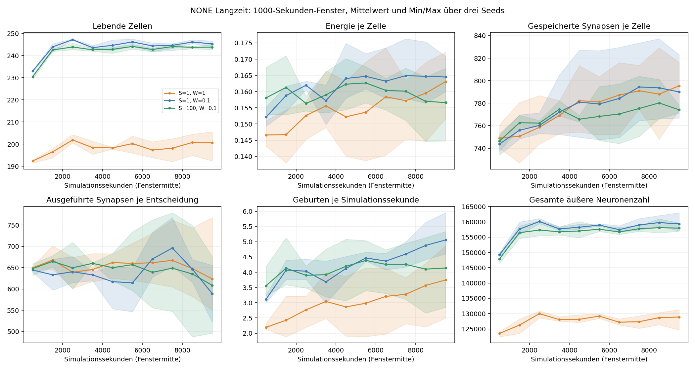

# Gehirnkosten unter NONE: Langzeitvergleich

**Alle neun Läufe vollständig abgeschlossen**, ohne Aussterben oder Erreichen der
Abbruchgrenze. Laufzeit: 16.10.2026, 07:07–15:00 Uhr, knapp acht Stunden.
Je Lauf 600.000 Schritte bei 60 Hz, also 10.000 Simulationssekunden.
Insgesamt **5,4 Millionen Schritte**. Drei Preise × drei Zufallsfolgen;
600 × 400 Pixel große periodische Bodenwelt mit denselben acht Gründern.

Versuchsaufbau: [NONE_ENERGIE.md](NONE_ENERGIE.md).
Kurzer Vorlauf: [NONE_ERGEBNISSE.md](NONE_ERGEBNISSE.md).
Ausgeführt mit Commit `3b9534fa286ec9f3f4eada29410ca70ab782003b`.
Standardparameter und Produktionslogik wurden für diese Auswertung nicht geändert.

## Ergebnis über das letzte Zeitfenster

Endstände schwanken durch Sonnenphase, Geburten und Todesfälle. Deshalb ist das
primäre Vergleichsfenster **Sekunde 9000–10000**, nicht nur der letzte Schritt.
Die Tabelle zeigt Mittelwerte über drei unabhängige Zufallsfolgen desselben
genetischen Startbestands. Klammern: Min/Max der drei Fensterwerte.

| Struktur / Berechnung | Lebende Zellen | Energie je Zelle | Synapsen je Netz | Ausgeführte Synapsen je Entscheidung | Äußere Neuronen je Netz | Geburten/s |
|---|---:|---:|---:|---:|---:|---:|
| 1 / 1, bisher | 200,6 (192–206) | 0,163 | 795,5 (774–816) | 623,6 (550–768) | 642,5 | 3,75 |
| 1 / 0,1 | 245,3 (244–247) | 0,164 | 790,0 (767–823) | 589,0 (522–656) | 649,5 | 5,06 |
| 100 / 0,1 | 243,8 (243–245) | 0,157 | 774,1 (771–778) | 608,4 (496–676) | 647,8 | 4,14 |

Am Start: 753,5 gespeicherte Synapsen und 643,5 äußere Neuronen je Netz.
Die mittlere Zellgeneration steigt von 129,9 auf etwa 492–611 in den Endbeständen;
damit liegen einige hundert natürliche Generationen zwischen Start und Ende.



Linien: Mittelwerte, Flächen: Min/Max über drei Zufallsfolgen. Keine
Konfidenzintervalle. Netzgrößen, Energie und Ausführungszahlen sind innerhalb
jedes Laufs nach Zellzeit gewichtet; große Populationen eines Seeds erhalten
beim anschließenden Mittel über Seeds kein zusätzliches Gewicht.

## Bewertung

### Geringere Rechengebühren tragen mehr Zellen

Die beiden günstigeren Varianten halten im letzten Fenster rund **22 % bzw.
21,5 % mehr Zellen** als bisherige Preise. Das gilt in allen drei gepaarten Seeds.
Die Populationen pendeln über viele Zyklen um diese unterschiedlichen Niveaus.

Der höhere Energiepuffer des kurzen Versuchs bleibt dagegen nicht allgemein
erhalten. Langfristig liegt die Energie pro Zelle unter 1/0,1 fast gleichauf
mit bisherigen Preisen; unter 100/0,1 liegt der Mittelwert sogar niedriger.
Der geringere Verbrauch wird vor allem in mehr Zellen und Zellumsatz umgesetzt.

Im letzten Fenster entstehen 3,75, 5,06 bzw. 4,14 Kinder je Simulationssekunde;
gleichzeitig sterben 3,77, 5,08 bzw. 4,16 Zellen/s. Diese Populationsbilanzen
messen keine individuelle Lebensdauer. Sie zeigen den hohen laufenden Austausch
bei ungefähr gleichbleibender Zellzahl.

### Der Strukturpreis bremst Wachstum, erzeugt aber keine kleinen Netze

Bei allen drei Preisen liegt die mittlere gespeicherte Synapsenzahl im letzten
Fenster über dem Ausgangswert: etwa **+5,6 %, +4,8 % und +2,7 %**.
Eine langfristige Rückentwicklung zu deutlich kleineren Netzen ist ausgeblieben.

Der Strukturpreis 100 hat im Mittel rund 2,0 % weniger Synapsen als 1/0,1 und
2,7 % weniger als bisherige Preise. Das ist ein Hinweis auf gebremstes Wachstum.
Der direkte Vergleich mit 1/0,1 fällt jedoch nur in zwei von drei Seeds günstiger
aus. Drei Starts mit demselben kleinen Startpool belegen noch keinen universellen
Vorteil dieses Preises.

Äußere Neuronen werden unter beiden günstigeren Varianten im Mittel sogar etwas
zahlreicher. Die gespeicherte Synapsenzahl alleine beschreibt deshalb den
Rechenaufwand unvollständig. Bei ungefähr 774 gespeicherten Synapsen kostet der
Strukturanteil mit Faktor 100 noch immer nur etwa 0,77 % des Grundverbrauchs.
Die Stärke dieses Selektionssignals ist entsprechend begrenzt.

### Gespeicherte und ausgeführte Struktur entwickeln sich verschieden

Ausgeführte Synapsen streuen deutlich stärker als gespeicherte. Beispielsweise
hat Seed 0 unter 1/0,1 im letzten Fenster etwa 780 gespeicherte, aber 522
ausgeführte Synapsen pro Entscheidung. Unter bisherigen Preisen sind es etwa
796 bzw. 768. Bei anderen Seeds wechselt die Richtung des Unterschieds.

Die Ausführungszähler erfassen die tatsächliche Vorwärtsrechnung. Sie erklären
allein nicht, ob ein Unterschied aus Zellzuständen, Layer-/Neuronensteuerung,
Modulnutzung oder einer veränderten Topologie stammt. Weniger Ausführung beweist
auch keinen Verlust von Funktion. Dafür braucht es den getrennten Funktionsvergleich.

Die angeforderte gesamte Gehirngebühr im letzten Fenster beträgt etwa
0,000748, 0,0000710 und 0,0000962 Energie je Zellsekunde: **24,9 %, 2,4 % und
3,2 % des Grundverbrauchs**. Diese Statistik verwendet die Gebühren vor Begrenzung
bei Energie null und die exakt gezählten Zellentscheidungen.

### Ein Performancegewinn ist weiterhin nicht nachgewiesen

Die gesamte äußere Neuronenzahl im letzten Fenster beträgt im Mittel etwa
128.873, 159.339 und 157.957. Gegenüber bisherigen Preisen sind das **24 % bzw.
22,6 % mehr Neuronen in der Welt**. Mehr Zellen kompensieren die kleine Abnahme
der Synapsenzahl pro Netz.

Die gemessenen Schrittzeiten über die kompletten Läufe sind im Mittel
4,36, 5,53 und 5,88 ms. Die Gehirnphase benötigt dabei etwa 2,96, 3,74 und
4,00 ms je Weltschritt. Diese Messungen enthalten Versuchsbuchhaltung,
unterschiedliche Populationen und möglichen sonstigen Rechnerbetrieb.
Die Varianten liefen nacheinander mit rotierender Preisreihenfolge, ohne
Darstellung. Die Zahlen sind beschreibend, kein isolierter CPU-Benchmark.

### Die kleine Welt bewahrt keine Gründer-Vielfalt

In jedem Lauf bleibt am Ende nur eine Gründerlinie. Der erste Messpunkt mit
genau einer Linie liegt zwischen 240 und 830 Simulationssekunden. Die meisten
Mutationen des langen Versuchs entstehen damit innerhalb der Nachkommen einer
einzelnen Startzelle. Eine Gründerlinie kann trotzdem viele spätere Genotypen
enthalten; die Messung ist kein Maß für deren genetische Vielfalt.

Die kleine, weitgehend gleichförmige Welt prüft daher nicht das langfristige
Nebeneinander verschiedener Nischenbewohner. Funktionale Zelltypen oder deren
Kooperation wurden in dieser Serie nicht gezielt bewertet.

## Konsequenz für das weitere Vorgehen

**Die Kosten allein liefern bislang nicht die gewünschte starke Netzverdichtung.**
1/0,1 bleibt wegen der Ergebnisse der Aufgabenexperimente ein Kandidat für
leichteren Funktionserwerb; in NONE führt dieser Preis vor allem zu mehr Zellen.
100/0,1 bremst das Strukturwachstum etwas, hat aber keinen belegten Vorteil für
die gesamte Laufzeit. Ein optimaler Standardpreis ist damit nicht bestimmt.

Als nächstes ist der angekündigte **Funktionsvergleich** sinnvoll: ausgewählte
Genome aus frühen und späten Speicherständen mit normaler Steuerung und
festgehaltenen Ausgaben unter vergleichbaren Bedingungen prüfen. Erst daraus
lässt sich ableiten, welche laufende Verarbeitung sich biologisch bezahlt macht.
Danach wäre eine deterministische Gebühr für aktive Neuronen/Ports/Layer zu
kalibrieren, sofern diese den tatsächlichen Aufwand besser abbildet.
Weitere reine Laufzeitverlängerungen desselben kleinen Szenarios haben derzeit
weniger Erkenntniswert als diese Untersuchung und andere Startbestände/Nischen.

## Datenprüfung und Reproduktion

- 9 vollständige Endstände, 9009 Verlaufszeilen und 90 Zwischenpopulationen samt
  90 Gründerzuordnungen. Die Zuordnungsdateien passen jeweils zur gemessenen
  Zellzahl und Anzahl verbleibender Gründerlinien.
- Alle **549 gemeinsamen Messpunkte der ersten 600 Sekunden** stimmen über ihre
  Zustandsfingerprints mit den kurzen Vorläufen überein. Dies prüft die erfassten
  Zustandsgrößen; der Fingerprint ist kein Hash des vollständigen inneren Netz-/RNG-Zustands.
- Für alle 109 gespeicherten `.cells`-Dateien (Quelle, Start, Ende, Zwischenstände)
  stehen Größen und SHA-256-Prüfsummen in `population-files.csv`. In jedem der
  neun Läufe ist der letzte Zwischenstand bytegleich mit `end.cells`.
- Rohdaten, Einstellungen, Start-/Endzeit, Commit und Auswertungen:
  [docs/none-energy/long](docs/none-energy/long/).
  Der vollständige Verlauf ist als `trajectory.csv.gz` archiviert.
- Die Populationen selbst bleiben lokal unter
  `experiments/none-energy-long-2026-10-16/`; sie sind wegen ihrer Größe nicht im Git-Commit.
  Dieser Ordner überlebt `mvn clean`.

Die 391 Routineprüfungen des Versuchsaufbaus und die späteren acht Prüfungen für
Kontrollen/Speicherstände bestanden vor dem Start. Die Langzeitserie bestand als
optionaler Test; die zusätzlichen Auswertungsprüfungen oben liefen ohne Fehler.
Für diese reine Datenauswertung wurde die Simulationslogik nicht geändert.

Auswertung aus dem bestehenden Versuchsordner wiederholen:

```powershell
python scripts/analyze_none_energy.py experiments/none-energy-long-2026-10-16 --output docs/none-energy/long
python scripts/analyze_none_energy_long.py experiments/none-energy-long-2026-10-16 --short experiments/none-energy-small-2026-10-16 --output docs/none-energy/long
```

Fenstermittel verwenden trapezförmige Integration der Messpunkte alle zehn
Sekunden. Geburten, Todesfälle und Gebühren stammen aus Differenzen kumulativer
Zähler an den Fenstergrenzen. Im ersten Fenster beginnt die Ausführungsstatistik
bei Sekunde 10, weil der transiente Ausführungszähler beim Laden noch keine
Entscheidungen repräsentiert. Die äußere Neuronenzahl schließt Modulinneres aus.
