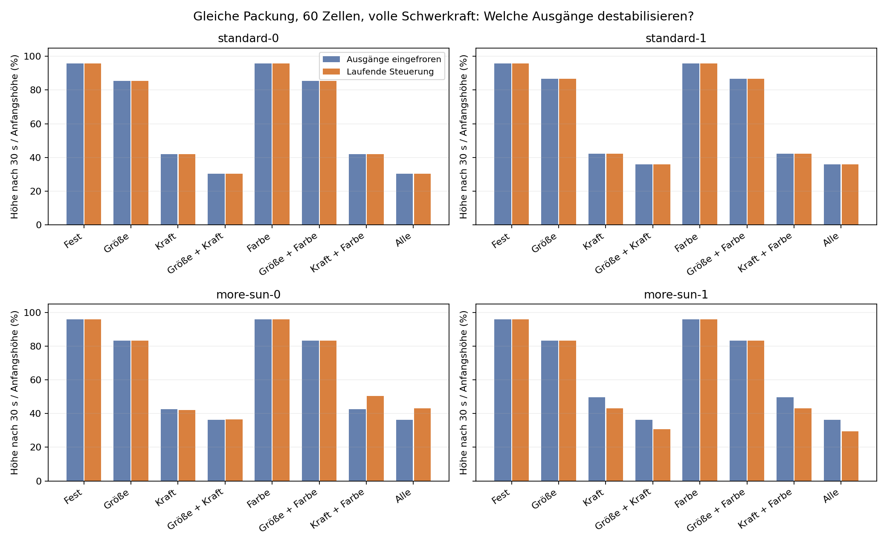
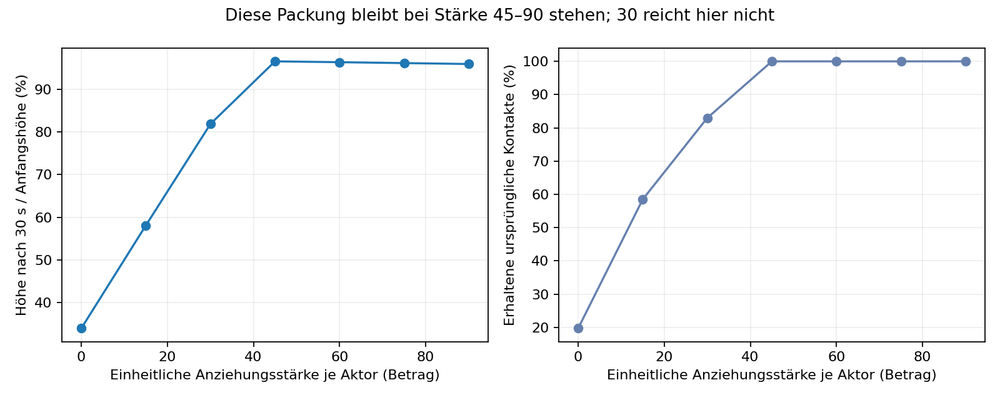

# Warum zerfließen die Verbände in HIGH_POSITION2?

## Ergebnis des isolierten Versuchs (15.10.2026)

Die Physik trägt den geprüften zwölfreihigen Verband. **Die vier untersuchten
Zellprogramme geben jedoch Kraftmuster aus, die diesen Verband nicht tragen.**
Der Zusammenbruch tritt bereits mit eingefrorenen Netzausgängen auf. Eine
instabile laufende Rückkopplung ist dafür also keine notwendige Voraussetzung.

Das korrigiert die vorherige Vermutung, dass vor allem die dauernde Änderung von
Größe, Kraft und Farbe den Verband destabilisiert. Bei diesen Programmen ist
bereits die gewählte Mischung aus Anziehung und Abstoßung ungeeignet.

## Aufbau

- 60 Zellen, fünf Spalten und zwölf versetzte Reihen, anfangs Radius 20.
- Immer gleiche Positionen und Rotation, oben eine seitliche Störung von 0,2.
- Welt 1400 × 1200, normaler Boden bei Y=1150; keine Seitenwände oder Verankerung.
- Unveränderte aktuelle Mechanik: Anziehung 90, Kontakt 125, Viskosität 0,8,
  Rotationsdämpfung 0,8/s, Feldweichzeichnung 0,25; volle Schwerkraft.
- Keine Teilung, kein Sonnenlicht, keine Energieübertragung. Vor jedem Schritt
  erhält jede Zelle Energie 0,75. Damit bekommen alle Gehirne denselben
  Energieeingang; normale Rechenkosten werden weiterhin berechnet.
- Keine Mutation oder Auswahl während des Versuchs. Keine Zellen entstehen oder
  sterben; endliche Positionen und die konstante Zellzahl werden geprüft.
- Pro Welt eine unveränderte Genomkopie in jeder Zelle, mit unabhängigem frischem
  Netzwerkzustand. Körperfarbe und Zellzustand stammen vom jeweiligen Spender;
  Alter startet bei null. Das ist ein Halteversuch mit klonalem Verband.

Spender sind jeweils Eintrag 0 und 1 aus `standard-best-parents.cells` und
`more-sun-best-parents.cells` unter `experiments/high-position2-2026-10-15`.
Die Namen bezeichnen ihre Herkunft. **Im aktuellen Versuch gibt es keinerlei
Unterschied der Sonnenenergie oder Teilungsrate zwischen diesen Programmen.**
Die Spender sind eine kleine, möglicherweise verwandte Auswahl, keine vier
unabhängigen Evolutionswiederholungen.

Für jedes Programm werden alle acht Kombinationen aus Größen-, Kraft- und
Aktorfarbsteuerung getestet. Gesperrte Ausgänge bedeuten Radiusziel 20,
einheitliche Anziehung -90 und grüne Aktoren. Alle übrigen Aktorausgänge sind null.
Bei freigegebenen Ausgängen wird entweder der erste vorgeschlagene Wert gehalten
oder der laufende Netzausgang übernommen. **Auch beim Einfrieren wird das Gehirn
in jedem Schritt mit den aktuellen Sensorwerten ausgeführt.**

64 Welten laufen je 30 Sekunden bei 60 Hz; vier zusätzliche Welten mit vollständig
freier Steuerung bei 120 Hz. Weitere sieben Welten vergleichen einheitliche
Anziehung. Insgesamt 75 Versuchswelten, 37,5 Minuten summierte Simulationszeit.

## Messungen

Höhe und Breite beziehen sich auf die äußeren Kugelränder, relativ zum Anfang.
Formfehler ist die RMS-Abweichung der Zellmittelpunkte nach optimaler starrer
Ausrichtung, geteilt durch den Anfangsradius 20. Schrumpfen zählt dabei als
Formänderung. Kontakte sind Paare mit Abstand höchstens R1+R2+0,1×min(R1,R2);
die Kontaktquote zählt erhaltene **ursprüngliche** Paare. Geschwindigkeit wird
über die letzten fünf Sekunden gemittelt. In der Zeitreihe ist `late_speed` bis
zum Beginn dieses Fensters null, danach der bisherige Fenstermittelwert, keine
momentane Geschwindigkeit. Geschwindigkeit allein unterscheidet keine
Verformung von einer gemeinsamen Bewegung.

### Laufende Steuerung bei 60 Hz

| Freigegebene Ausgänge | Resthöhe nach 30 s | Breite relativ zum Anfang | Befund |
|---|---:|---:|---|
| Keine | 95,9 % | 0,981 | Steht, alle ursprünglichen Kontakte erhalten |
| Nur Größe | 83,2–86,8 % | 0,858–0,891 | Schrumpft auf R≈17,4–18,1, kommt zur Ruhe, alle Kontakte erhalten |
| Nur Kraft | 41,8–43,2 % | 3,36–3,78 | Bricht zusammen und breitet sich aus |
| Nur Farbe | 95,9 % | 0,981 | Steht |
| Alle | 29,4–43,0 % | 3,02–3,68 | Bricht zusammen; nur 31–35 % der ursprünglichen Kontakte bleiben |



Mit **eingefrorener** Kraftsteuerung bleiben bei festem Radius nur 41,8–49,6 %
der Höhe. Damit ist eine zeitlich veränderliche Steuerung nicht erforderlich,
um den Zusammenbruch hervorzurufen. Bei den beiden `standard`-Programmen stimmen
die eingefrorenen und laufenden Varianten in den aufgezeichneten Messwerten
überein. Bei den anderen Programmen gibt es Unterschiede, aber keine Rettung
des Verbandes. Farbe kann über die Netze indirekt wirken.

Die Kraftausgänge sind keine einheitliche schwache Anziehung: Sie mischen
anziehende und abstoßende Aktoren. Bei vollständig freier Steuerung beträgt
der mittlere Betrag etwa 27–29; der vorzeichenbehaftete Mittelwert liegt nur
zwischen -0,26 und -0,88. Einzelne Aktoren erreichen etwa -52 bis +84.
Dieser Mittelwert ist **keine berechnete Nettokraft am Verband**: Reichweite,
Abstand, Richtung und Radius skalieren jeden Beitrag zusätzlich.

Wichtig für die Interpretation: `SensorActorForceCellCalcService` verwendet
**keine Farbübereinstimmung zur Berechnung mechanischer Kräfte**. Die frühere
Annahme, Aktorfarben änderten unmittelbar die Haftung, trifft im aktuellen Code
nicht zu. Farben sind hier Sensorinformationen für die Gehirne; die reine
Farbfreigabe bei ansonsten festen Ausgängen kann daher keine andere Mechanik
erzeugen.

Bei 120 Hz bleiben mit vollständig freier Steuerung 31,5–42,9 % Höhe übrig;
die Breite wächst auf das 2,66–3,34-Fache. Einzelne Endformen unterscheiden sich
deutlich von 60 Hz. Der Befund „Zusammenbruch“ bleibt bestehen; eine allgemeine
Unabhängigkeit der komplexen Dynamik von der Schrittweite wird damit nicht belegt.

### Einheitliche Anziehung

| Betrag je Aktor | Resthöhe | Erhaltene ursprüngliche Kontakte |
|---:|---:|---:|
| 90 | 95,9 % | 100 % |
| 75 | 96,1 % | 100 % |
| 60 | 96,3 % | 100 % |
| 45 | 96,5 % | 100 % |
| 30 | 81,8 % | 83,0 % |
| 15 | 58,1 % | 58,5 % |
| 0 | 33,9 % | 19,7 % |



Die getesteten Stärken 45, 60, 75 und 90 tragen diese Packung. Mehr Anziehung
komprimiert sie etwas stärker. Das ist ein brauchbarer physikalischer Bereich,
kein universeller Grenzwert: andere Radien, Geometrien, Störungen und anisotrope
Kraftmuster können andere Werte benötigen. Die Messung gilt für 30 Sekunden.

## Was bedeutet das für die Evolution?

Der Versuch zeigt einen konkreten Unterschied zwischen einer tragfähigen
Steuerung und den ausgewählten evolvierten Programmen. Er erklärt noch nicht,
warum Mutation und Auswahl keine tragfähige Steuerung entdecken. Vor allem
beweist ein bereits aufgebauter Turm noch keine erfolgreiche Entwicklung eines
Turmes aus einer einzelnen Zelle. Die Energieeingänge und Nachbarschaften sind
hier bewusst andere als in den Herkunftsläufen.

Der daraus entstandene Modus ist in [HIGH_POSITION3.md](HIGH_POSITION3.md)
beschrieben. Ausgangspunkt war ein separates HIGH_POSITION3 mit einem
schrittweisen Aufbau der Aufgabe verwenden:

1. Zunächst den vorgegebenen Verband mit laufenden Gehirnen halten. Gleiche
   Zellzahl und Energie; zuerst nur Kräfte freigeben. Bewertung über die ganze
   Episode: bodenverbundene Höhe halten und ursprüngliche Nachbarschaft erhalten.
2. Seitliche Störungen ergänzen und Rückkehr zur Form bewerten. Gemeinsame
   Translation und Rotation nicht als Verformung bestrafen.
3. Größe und weitere Zustände freigeben; Gelenkigkeit anschließend mit einer
   gewünschten Bewegung belohnen. Eine allgemeine Strafe auf Geschwindigkeit
   würde später auch nützliche Bewegung verhindern.
4. Erst danach den Aufbau aus wenigen Zellen prüfen. Frühe bodenverbundene Höhe
   über die Zeit belohnen, damit schnelles Bauen tatsächlich einen Vorteil hat.

So ließe sich testen, ob die Mutation bereits die einfachere Halteaufgabe lösen
kann. Weder dauerhafte maximale Anziehung noch ein starres Skelett müssten der
Evolution dafür vorgeschrieben werden. HIGH_POSITION2 und Produktionsphysik
wurden durch diese Untersuchung nicht geändert.

## Reproduktion und Prüfungen

```powershell
& C:/Users/thomas/.maven/maven-3.10.0/bin/mvn.cmd -B -ntp test `
  '-Dtest=ControllerStabilityStudyTest' '-Dcontroller.study=true' `
  '-DargLine=-Djava.util.concurrent.ForkJoinPool.common.parallelism=4'
python scripts/analyze_controller_stability.py target/controller-stability
```

Optional: `-Dcontroller.input=...` (Ordner der zwei Eltern-Dateien),
`-Dcontroller.output=...`. Die große Untersuchung läuft nicht bei normalen Tests.
CSV-Daten und geprüfte Abbildungen liegen unter `docs/controller-stability`.
Spenderdateien bleiben lokal im ignorierten `experiments`-Ordner.

SHA256 der Spenderdateien:

- standard: `5B7BE4BCED3BD76E3019B189EE25AB62BC7B2844A4C1D78952C1CAFDFD4A7A5E`
- more-sun: `0020A93D25D34E704B2A4B6570423D9BF7CC8E7B10D4734B3A306A88B6E2406A`

31 gezielte Regressionstests bestanden: fünf neue Tests für Ausgangsmasken,
Einfrieren bei weiterlaufender Berechnung und die mechanischen Kontrollen,
vier Standtests, 16 Fitness- und sechs Auswahltests. Beide optionalen
Untersuchungsmethoden bestanden ebenfalls; keine NaN oder Änderungen der Zellzahl.
