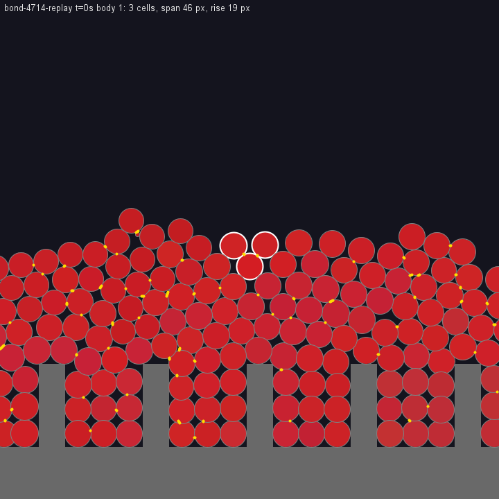
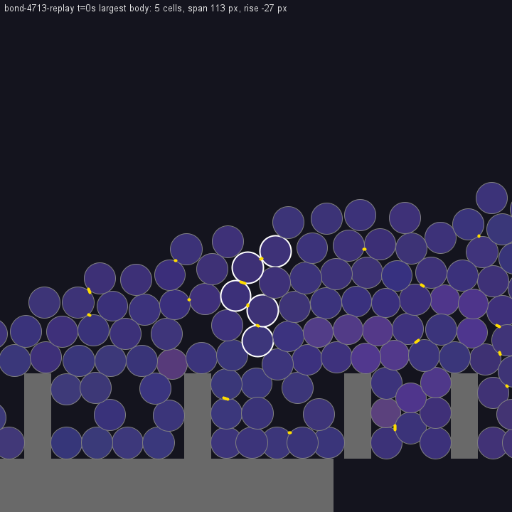

# Dauerhafte Zellverbindungen – Entwurf

Status: **Stufe 1 und 2 umgesetzt** (17.10.2026, Standard an); **Stufe 3 und 4 experimentell
umgesetzt** (18.10.2026, eigene Schalter, Standard aus). Ziel sind Stängel und Stützstrukturen
aus gemeinsamer DNA, die Gehirnpausen und einzelne Todesfälle überstehen. Dazu soll
die Abweisung fremder Zellen kommen, die starkem Druck aber nachgibt. Grundlage sind
die bestehenden Aktorfelder (`SensorActorForceCellCalcService`), keine zweite Mechanik.

## Umsetzung Stufe 1 und 2 (17.10.2026)

Entscheidungen des Nutzers: Überreste lassen nach 300 s Halbwertszeit los, „Holz“ (∞) ist
wählbar; Haftung kostet vorerst nichts; Mimikry soll möglich, aber durch weitere Merkmale
auflösbar sein; erst Stufe 1/2, dann messen.

- Aktiv nur in der Policy `SimulationStepPolicy.OPEN_WORLD` (Default-NONE-Welt der GUI und
  der Zonenstudie) und wenn der GUI-Schalter „Cell adhesion“ an ist (Standard an).
  `SimulationStepPolicy.NONE` (Testwelten) und Trainings bleiben unverändert.
- **Tonus** (`CellAdhesionService.settleForces`, nach dem Denken): wirksame Kraft
  `F ← F_alt + (Befehl − F_alt)·(1 − e^(−dt/τ))`, τ = 0,5 s. Pausierte Zellen
  (`BrainEnergyService.prepare(..., holdForces)`) behalten ihre Kräfte; Energieabgabe
  und Teilungswunsch werden weiter genullt. Überreste (`becomeRemains(true)`) behalten
  ihre Kräfte und verlieren sie mit Halbwertszeit `remainsForceHalfLife` (300 s, GUI 1–60 min
  oder ∞). Gespeicherte Überreste behalten ihre gespeicherten Felder (ältere Dateien: 0).
- **Erkennung** (`SensorActorForceCellCalcService.Affinity`):
  `a = Ähnlichkeit(Aktorfarben)^k · Ähnlichkeit(Körperfarben)^k`, k = 4, Ähnlichkeit =
  `CellType.similarity` (1 − RMS-Abstand). Anziehung `s < 0` wirkt als `s·a − s·(1 − a)·ρ`,
  ρ = 0,5 (GUI 0–100 %). Abstoßung wirkt wie bisher auf alle. Die Körperfarbe ist
  vererbt und mutiert nur langsam bei der Teilung, das Gehirn kann sie nicht steuern.
  Aktorfarben-Mimikry allein genügt daher nicht: Gleiche Aktorfarbe auf fremdem Körper
  wird weiter abgewiesen (Test). Eine langsam evolvierte Körperfarbe kann das aufheben.
- **Überwindbar** (Test, zwei Zellen Radius 20, alle Aktoren −90, fremde Aktorfarbe,
  äußerer Druck 3 s): Ein bis zwei Zellgewichte (Schwerkraft 29,4) werden mit Abstand
  abgehalten, zehn Zellgewichte drücken die Zellen in Kontakt. Grenze bei ρ = 0,5 etwa
  drei Zellgewichte. Bei Radius 10 wirkt das Feld nur ein Viertel so stark (Größenskalierung
  `r₁·r₂/r_max²`), dort reicht ein Zellgewicht.
- Tests: `CellAdhesionTest` (6), GUI in `MainControllerLayoutTest`; unverändert grün:
  `ForceSignTest`, `PhysicsRegressionTest`, Gehirnenergie-, Notatmungs-, Drossel- und
  Vererbungstests.
- Zonenstudie: Schalter `-Dzone.study.adhesion=false` für die Kontrolle; neue Spalten
  `attractive` (Anteil anziehender Aktoren lebender Zellen), `pausedAttractive` (dasselbe
  bei pausierten), `largestCluster` (größte Gruppe sich berührender Zellen inkl. Überresten,
  Spalt ≤ 2 px), `clusterRemains`, `clusterLift` (höchste Zelle dieser Gruppe über Gelände).

## Umsetzung Stufe 3 und 4 (18.10.2026, experimentell)

Der Nutzer wollte beide Stufen nur schaltbar haben. GUI: zwei Kästchen „Experimental“
im Umweltpanel. Config: `adhesionBonds` (Stufe 3) und `adhesionBirthBonds` (Stufe 4),
beide standardmäßig aus. Sie wirken nur, wenn die Zellhaftung (OPEN_WORLD) an ist.
Studie: `-Dzone.study.bonds=true`, `-Dzone.study.birthbonds=true`.

- **Bindung** (`SensorActor.bond`): Beide Aktoren speichern Partner und eingefrorene
  Stärke. Im Feld dieses Paares (`SensorActorForceCellCalcService`) wirkt statt der
  Gehirnbefehle und der Farb-Affinität die Bindungsstärke × `bondFieldFactor` (3). Alle
  anderen Paare bleiben unverändert. Mit Faktor 1 war eine Bindung eine zu weiche Feder:
  Eine Säule verlor bei einem Seitenstoß 3 von 6 Bindungen. Mit 2–3 hielten alle.
- **Einrasten** (`CellAdhesionService.updateBonds`): Der Durchgang läuft nach der Bewegung,
  seit 24.10.2026 in zwei Phasen: eigene Aktoren parallel (Anker, Timer), Paare seriell in
  fester Listenreihenfolge. Ein im Schritt gelöster Aktor rastet erst im nächsten Schritt neu
  ein; ein verankerter Aktor nimmt keinen Partner (`PERFORMANCE.md`). Bedingungen:
  - zwei lebende Zellen, deren Aktoren sich gegenseitig als nächsten Aktor wahrnehmen;
  - beide Aktoren anziehend;
  - Affinität ≥ 0,8 (bei aktiver Erkennung);
  - Abstand ≤ halbe Feldreichweite, 0,5 s lang.
  Die Stärke ist die schwächere der beiden Anziehungen. Jeder Aktor hat höchstens einen
  Partner.
- **Lösen:**
  - Der Abstand übersteigt die größere Feldreichweite.
  - Ein denkendes Gehirn steuert den Aktor 0,5 s lang abstoßend. Pausierte Zellen
    lösen nicht.
  - Der Partner hat die Welt verlassen oder wurde nicht mitgespeichert.
  - Bei Überresten klingt die Stärke mit deren Halbwertszeit ab; unter 0,001 endet die
    Bindung.
- **Geburtsbindung** (`CellAdhesionService.bindAtBirth`, nach erfolgreicher Teilung):
  Der Aktor der Mutter, der dem Kind am nächsten ist, wird mit dem Aktor des Kindes
  verbunden, der zur Mutter zeigt. Voraussetzung ist, dass der Mutteraktor anzieht und
  noch frei ist. Die Bindung übernimmt die Stärke des Mutteraktors. Das Kind ist anfangs
  sehr klein, die Feldskala `r₁·r₂/r_max²` wächst mit ihm.
- Speicherung: Partner werden mitserialisiert, alte Dateien haben keine Bindungen.
- Nicht umgesetzt (aus dem Entwurf): bevorzugte Wahrnehmung des Partners und ein
  Gehirneingang „gebunden“.
- Tests: `CellBondTest` (6), unter anderem eine Säule aus vier Zellen mit Seitenstoß.
  - Lose Säule: zerfällt (Endabstand 40 px).
  - Säule mit je zwei Bindungen pro Gelenk: bleibt ein gerader Körper (Endabstand 108 statt
    120 px durch etwa 10 % Kontaktüberlappung, Abweichung 0), **kippt aber als Ganzes um**.
  - Ein steifer Stab auf einer runden Fußzelle ist instabil. Stehen braucht eine breite,
    verbundene Basis oder Halt am Boden; beides gibt es bisher nicht.
- Kurzer Rauchtest (Zonenstudie, 180 s, beide Schalter an): 179 Bindungen, größter
  gebundener Körper 15 Zellen, höchstes Glied 141 px über Gelände. Die Rechenzeit war
  spürbar höher; vier weitere Läufe liefen parallel, ein sauberer Vergleich fehlt.

## Vergleichsläufe Stufe 1/2 (17./18.10.2026)

Zonenstudie (`ZoneSeasonStudyTest`, Modellstand `c3679a6`), je 3600 s, Lebensdauer 2000 s,
Spektralzonen an, vier Läufe parallel. Haftung an gegen Kontrolle
(`-Dzone.study.adhesion=false`, entspricht dem Modell vor Stufe 1/2). Ohne Jahreszeiten
Seed 4711, mit Jahr 600 s und Winterlicht 50 % Seed 4713. Daten:
`target/zone-season-study/{adh,ctrl}-{noseasons,seasons50}.csv` (nicht versioniert).

Werte: Mittel über die zweite Hälfte (t > 1800 s) / Maximum über den ganzen Lauf.

| Kennzahl | Haftung, ohne JZ | Kontrolle, ohne JZ | Haftung, Winter 50 % | Kontrolle, Winter 50 % |
|---|---|---|---|---|
| Lebende Zellen | 437 / 627 | 316 / 391 | 437 / 723 | 183 / 383 |
| Minimum lebend | 221 | 234 | 127 | 55 |
| Pausierte Gehirne | 1,3 / 28 | 14 / 38 | 13 / 88 | 20 / 79 |
| Überreste | 132 / 181 | 212 / 280 | 123 / 201 | 164 / 206 |
| Anziehende Aktoren pausierter Zellen | 0,4 | 0 | 0,4 | 0 |
| Zone 001 lebend | 0 / 24 | 0,2 / 45 | **92 / 399** | 0,9 / 51 |
| Zone 010 lebend | 0 / 24 | 0 / 7 | **151 / 307** | 0 / 28 |
| Zone 100 lebend | 58 / 215 | 14 / 46 | 7,5 / 56 | 3,7 / 23 |
| Zellen mit Zonenform → 000 (001/010/100) | 0 / 0 / 7 | 0 / 0 / 0 | **36 / 55 / 0** | 0,2 / 0 / 0 |
| Größter Kontaktverband | 387 / 623 | 411 / 531 | 207 / 517 | 142 / 350 |
| davon Überreste | 4,6 | 102 | 3,9 | 1,4 |
| Höchste Zelle dieses Verbands über Gelände (px) | 153 / 205 | 169 / 195 | 124 / 205 | 128 / 215 |
| `maxLift` (px) | 154 / 205 | 169 / 195 | 135 / **500** | 136 / 216 |
| Mittleres Alter (s) | 343 | 500 | 348 | 158 |

Beobachtungen:

- Mit Haftung leben in beiden Bedingungen deutlich mehr Zellen, mit Winter mehr als doppelt
  so viele. Das Minimum im Winter liegt bei 127 statt 55.
- **Erstmals ist die 010-Zone dauerhaft besiedelt** (Winterlauf mit Haftung, ab etwa 800 s,
  bis 307 Zellen, bis 86 mit 010 → 000), dazu die 001-Zone über den ganzen Lauf. In der
  Kontrolle sind beide Fremdzonen ab etwa 300 s praktisch leer.
- Aas: Im Winterlauf mit Haftung sinkt das 010-Aas von 48 (300 s) auf 3–15. In der
  Kontrolle bleiben 001- und 010-Aas unverändert liegen (45–50 bzw. 33,4).
- Ohne Jahreszeiten ist die 100-Zone mit Haftung stärker besiedelt (58 statt 14 im Mittel).
- In der Kontrolle besteht der größte Kontaktverband ohne Jahreszeiten zu einem Viertel aus
  Überresten (102 von 411). Mit Haftung sind es kaum welche, insgesamt gibt es weniger
  Überreste. Ursache ungeprüft: Abweisung oder ein schnellerer Abbau könnten beitragen.
- **Höhe:** Der größte Verband ist mit Haftung nicht höher (Spitze etwa 205 px in allen
  Läufen). Der einmalige `maxLift` von 500 px (900 s, Winter mit Haftung) gehört nicht zum
  größten Verband. Ob das eine gehaltene Struktur oder eine geschleuderte bzw. fallende Zelle
  war, verrät die Momentaufnahme nicht. **Stängel sind weiterhin nicht nachgewiesen.**
- Pausierte Zellen halten wie vorgesehen Anziehung (Anteil 0,4 gegen 0).

Grenzen: Pro Bedingung gibt es nur einen Lauf, und Läufe mit gleichem Seed sind nicht
bitgenau reproduzierbar. Ein früherer Kontrolllauf mit Seed 4713 (Lebensdauer 2000 s)
hatte selbst eine 001-Kolonie (ZONEN_JAHRESZEITEN_ERGEBNISSE.md). Der Vorteil der Haftung
ist also ein deutlicher Hinweis, aber noch kein gesicherter Effekt. Wodurch die Haftung
Besiedlung und Population fördert, ist ungeklärt. Mögliche Ursachen:
- Zusammenhalt verwandter Zellen in Pausen;
- Abweisung fremder Zellen;
- ruhigere Kräfte durch den Tonus.
Das wäre mit getrennten Schaltern zu prüfen. **Ergebnis: siehe nächster Abschnitt; der Vorteil
hat sich nicht bestätigt.**

## Seed-Wiederholung und Ablation Stufe 1/2 (18.10.2026)

Modellstand `03a03fc`, in einem eigenen Worktree, damit Codeänderungen die Läufe nicht
berühren. Alle Läufe: Zonenstudie 3600 s, Lebensdauer 2000 s, Jahr 600 s, Winterlicht 50 %,
vier Läufe parallel. Seed 4713 sind die Läufe `adh-seasons50`/`ctrl-seasons50` aus dem
vorigen Abschnitt. Ablationen mit je einem abgeschalteten Teil, die übrigen Teile bleiben an:
- `nohold`: `-Dzone.study.hold=false`, Pause wirkt wie ein Nullbefehl;
- `norecog`: `-Dzone.study.recognition=false`, farbblind;
- `notonus`: `-Dzone.study.tonus=0`.
Daten: `LifeCircles-runs/target/zone-season-study/abl-*.csv` (nicht versioniert).
Auswertung: Skript im Sitzungs-Scratchpad.

Spalten:
- Lebende Zellen: Mittel über den ganzen Lauf, Minimum ab 300 s, Endwert, Mittel der
  zweiten Hälfte (t > 1800 s).
- Zonen und Folgespalten: Mittel der zweiten Hälfte.
- Zonen ≥ 5: Zahl der Zonen mit mindestens fünf lebenden Zellen.
- Verband: größter Kontaktverband.

| Lauf | Seed | Ø | Min | Ende | 2. Hälfte | Z000 | Z001 | Z010 | Z100 | Zonen ≥ 5 | Pause % | Verband | Verband Höhe | maxLift |
|---|---|---|---|---|---|---|---|---|---|---|---|---|---|---|
| Haftung | 4711 | 160 | 40 | 180 | 151 | 147 | 0 | 0 | 5 | 1,1 | 15 | 95 | 97 | 111 |
| Haftung | 4712 | 222 | 55 | 239 | 219 | 201 | 0 | 0 | 18 | 1,8 | 2 | 209 | 169 | 172 |
| Haftung | 4713 | 383 | 127 | 543 | 437 | 186 | 92 | 151 | 7 | 3,3 | 3 | 207 | 124 | 135 |
| Haftung | 4714 | 144 | 29 | 165 | 136 | 133 | 0 | 0 | 3 | 1,1 | 23 | 80 | 83 | 106 |
| Kontrolle | 4711 | 161 | 25 | 34 | 110 | 52 | 56 | 0 | 2 | 1,6 | 3 | 78 | 70 | 73 |
| Kontrolle | 4712 | 186 | 66 | 204 | 170 | 170 | 0 | 0 | 1 | 1,1 | 2 | 130 | 112 | 119 |
| Kontrolle | 4713 | 159 | 57 | 297 | 183 | 178 | 1 | 0 | 4 | 1,3 | 10 | 142 | 128 | 136 |
| Kontrolle | 4714 | 209 | 55 | 328 | 210 | 197 | 3 | 0 | 10 | 1,5 | 20 | 221 | 138 | 155 |
| ohne Halten | 4711 | 106 | 33 | 277 | 110 | 109 | 0 | 0 | 0 | 1,0 | 40 | 104 | 89 | 105 |
| ohne Halten | 4713 | 150 | 45 | 298 | 134 | 133 | 0 | 0 | 0 | 1,0 | 17 | 83 | 93 | 109 |
| ohne Erkennung | 4711 | 180 | 20 | 180 | 166 | 158 | 0 | 0 | 7 | 1,4 | 18 | 122 | 111 | 118 |
| ohne Erkennung | 4713 | 228 | 76 | 403 | 263 | 243 | 0 | 0 | 21 | 1,7 | 7 | 260 | 256 | 256 |
| ohne Tonus | 4711 | 202 | 59 | 306 | 224 | 87 | 137 | 0 | 0 | 2,0 | 9 | 143 | 96 | 107 |
| ohne Tonus | 4713 | 181 | 37 | 246 | 153 | 150 | 0 | 0 | 3 | 1,2 | 10 | 98 | 98 | 107 |
| **Ø Haftung** | 4 | 227 | 63 | 282 | 236 | 167 | 23 | 38 | 8 | 1,8 | 11 | 148 | 118 | 131 |
| **Ø Kontrolle** | 4 | 179 | 51 | 216 | 168 | 149 | 15 | 0 | 4 | 1,4 | 9 | 143 | 112 | 121 |
| Ø ohne Halten | 2 | 128 | 39 | 288 | 122 | 121 | 0 | 0 | 0 | 1,0 | 28 | 93 | 91 | 107 |
| Ø ohne Erkennung | 2 | 204 | 48 | 292 | 215 | 200 | 0 | 0 | 14 | 1,6 | 12 | 191 | 183 | 187 |
| Ø ohne Tonus | 2 | 192 | 48 | 276 | 189 | 118 | 68 | 0 | 2 | 1,6 | 10 | 120 | 97 | 107 |

Befund:
- **Der große Vorteil aus Seed 4713 wiederholt sich nicht.**
  - Zweite Hälfte, Haftung minus Kontrolle je Seed: +41, +49, +254, −74. Bei 4714 ist
    die Kontrolle klar besser.
  - Winterminimum: zwei Seeds besser, zwei schlechter.
  - Die dauerhaft besiedelte 010-Zone gibt es nur im Lauf 4713 mit Haftung. Kein anderer
    Lauf zeigt sie, auch keine Ablation mit Seed 4713.
  - Gleicher Seed bedeutet hier keinen gepaarten Vergleich, weil die Läufe nicht bitgenau
    reproduzierbar sind und schon kleine Regeländerungen die Geschichte umlenken.
  - Im Mittel liegt die Haftung etwas vorn (236 gegen 168 lebende Zellen). Das hängt aber
    fast ganz an 4713 und liegt in der Streuung zwischen den Läufen. Ein Nutzen ist
    **nicht gesichert**, ein Schaden aber auch nicht.
- **Ohne Halten** ist in beiden Seeds der schwächste Haftungsstand:
  - 122 lebende Zellen in der zweiten Hälfte, nur die 000-Zone besiedelt;
  - deutlich mehr pausierte Gehirne (28 % gegen 11 %).
  - Ohne Halten wirkt eine Pause wie ein Nullbefehl, der durch den Tonus nachgeführt
    wird; Verwandte verlieren in Pausen also ihre Anziehung.
  - Das liegt auch unter der Kontrolle (168). Nur 2 Seeds, also ein schwacher Hinweis:
    Tonus und Abweisung ohne Halten scheinen eher zu schaden.
- **Ohne Erkennung** (farbblinde Anziehung):
  - größere und höhere Kontaktverbände (Ø 191 Zellen, Verbandshöhe 183 px, Seed 4713:
    256 px, der höchste Wert der Reihe);
  - Population etwa wie mit voller Haftung.
  - Wenn alle sich anziehen, klumpt mehr zusammen. Für Höhe ist die Abweisung damit eher
    hinderlich.
- **Ohne Tonus**: kein klares Bild. Seed 4711 hat eine 001-Kolonie (137 Zellen), die auch
  die Kontrolle 4711 kurzzeitig hatte. Seed 4713 liegt bei der Kontrolle.
- Höhe: kein Lauf zeigt Stängel. `maxLift` liegt in der zweiten Hälfte im Mittel bei
  105–190 px.

Folgerung: Stufe 1/2 bleibt eingeschaltet, weil sie die beabsichtigte Mechanik liefert und
nicht messbar schadet. Die frühere Aussage „deutlich mehr Zellen und besiedelte 010-Zone“
ist zurückgezogen; sie war ein Einzellauf. Ein belastbarer Populationsvergleich bräuchte
etwa 8–10 Läufe je Bedingung. Auf dieser Rechenzeit lohnt das eher mit kürzeren Läufen
oder einer kleineren Welt.

## Vergleich Bindungen gegen Stufe 1/2 (18.10.2026)

Modellstand `4e8e678` (eigener Worktree), Seeds 4711–4714, je 3600 s, Lebensdauer 2000 s,
Jahr 600 s, Winterlicht 50 %, zwei Läufe parallel.
- `bond`: Stufe 3 und 4 an (`-Dzone.study.bonds=true -Dzone.study.birthbonds=true`).
- `base`: nur Stufe 1/2, auf demselben Stand neu gerechnet.

Daten: `LifeCircles-runs/target/zone-season-study/{bond,base}-*.csv` (nicht versioniert).
Werte: Mittel der zweiten Hälfte (t > 1800 s), falls nicht anders angegeben.
- Gebunden: größter gebundener Körper (Zellen) und Höhe seines höchsten Glieds über
  Gelände. Gemessen wird die Lücke unter der Zelle, darunterliegende Zellen zählen mit.
- Spitze: Maximum über den ganzen Lauf.

| Lauf | Seed | Lebend | Min | Ende | Z000 | Z001 | Z100 | Pause % | Überreste | Verband | Verband Höhe | maxLift | Bindungen | Gebunden | Gebunden Höhe | Spitze Körper / Höhe |
|---|---|---|---|---|---|---|---|---|---|---|---|---|---|---|---|---|
| Bindungen | 4711 | 82 | 35 | 43 | 82 | 0 | 0 | 6 | 167 | 52 | 84 | 82 | 60 | 6 | 25 | 21 / 119 |
| Bindungen | 4712 | 243 | 27 | 483 | 210 | 0 | 33 | 25 | 188 | 260 | 198 | 195 | 162 | 12 | 120 | 26 / 211 |
| Bindungen | 4713 | 292 | 47 | 531 | 254 | 0 | 38 | 2 | 241 | 366 | 241 | 233 | 126 | 15 | 133 | 45 / 261 |
| Bindungen | 4714 | 296 | 72 | 430 | 267 | 0 | 28 | 3 | 174 | 360 | 168 | 171 | 130 | 9 | 113 | 14 / 191 |
| Stufe 1/2 | 4711 | 357 | 79 | 447 | 227 | 87 | 43 | 6 | 120 | 232 | 131 | 149 | – | – | – | – |
| Stufe 1/2 | 4712 | 94 | 39 | 132 | 94 | 0 | 0 | 7 | 195 | 59 | 75 | 97 | – | – | – | – |
| Stufe 1/2 | 4713 | 113 | 9 | 45 | 113 | 0 | 0 | 22 | 162 | 92 | 83 | 110 | – | – | – | – |
| Stufe 1/2 | 4714 | 299 | 123 | 416 | 245 | 22 | 32 | 3 | 190 | 226 | 158 | 163 | – | – | – | – |
| **Ø Bindungen** | 4 | 228 | 45 | 372 | 203 | 0 | 25 | 9 | 193 | 259 | 173 | 170 | 119 | 11 | 98 | 26 / 196 |
| **Ø Stufe 1/2** | 4 | 216 | 62 | 260 | 170 | 27 | 19 | 9 | 167 | 152 | 112 | 130 | – | – | – | – |

Die 010-Zone ist in keinem Lauf besiedelt.

Befund:
- **Bindungen entstehen und halten:** etwa 120 gleichzeitig, der größte gebundene Körper hat
  im Mittel 11 Zellen, die Spitze lag bei 45 Zellen.
- **Höhere Verbände:** Mit Bindungen ist der größte Kontaktverband im Mittel größer (259
  gegen 152 Zellen) und höher (173 gegen 112 px). Auch `maxLift` ist höher (170 gegen
  130 px). Bei drei von vier Seeds liegt der Verband über 160 px; ohne Bindungen schaffen
  das nur einer von acht Stufe-1/2-Läufen (dieser Abschnitt und der vorige).
- **Gebundene Körper ragen nicht allein auf:** Ihre Höhe (Ø 98 px, Spitze 261 px) liegt
  unter der des Kontaktverbands. Sie sitzen also in oder auf dem Haufen. Ob es dort
  selbsttragende Stäbe gibt, zeigen die Kennzahlen nicht; dafür fehlen Momentaufnahmen mit
  Bindungen. **Stängel sind weiterhin nicht nachgewiesen.**
- **Population:** gleich im Rahmen der Streuung (228 gegen 216).
- **Fremdzonen:** Mit Bindungen ist die 001-Zone in keinem Lauf besiedelt, mit Stufe 1/2
  zweimal. Bei vier Läufen ist das nur ein Hinweis.
- **Streuung:** Gleiche Einstellung, gleicher Seed, verschiedene Läufe von Stufe 1/2 liegen
  bei 357 gegen 151 (4711) oder 113 gegen 437 (4713) lebenden Zellen. Populationsunterschiede
  unter etwa Faktor 2 sind mit vier Läufen nicht zu trennen. Über alle acht Läufe von
  Stufe 1/2 liegt das Mittel bei 226, die Kontrolle ohne Haftung bei 168 (4 Läufe).
- Rechenzeit: Mit Bindungen ist sie kaum anders. Je Paar dauerte ein Lauf etwa 20–35 min.

Folgerung: Bindungen sind die erste Regel, die die Verbände messbar größer und höher macht.
Sie bleiben trotzdem experimentell und standardmäßig aus, bis klar ist, welche Form diese
Verbände haben. Nächster Schritt wäre eine Momentaufnahme mit Bindungslinien bzw. eine
Kennzahl „Höhe über dem Rest des Verbands“, dazu die Standfestigkeit (Bodenhalt, Basis).

## Momentaufnahmen und Überstand gebundener Körper (18.10.2026)

Werkzeuge (nur Testcode, `module-info` braucht dafür `java.desktop`):
- **Momentaufnahme** (`BondSnapshotImage`): PNG mit Zellen in Körperfarbe, Überresten
  abgedunkelt, Gelände grau und Bindungen als gelbe Linien zwischen den gebundenen Aktoren.
  Die Zonenstudie schreibt am Ende, mit `-Dzone.study.snapshot=SEKUNDEN` auch zwischendurch:
  - `NAME-tT.png`: ganze Welt, Maßstab 1:4;
  - `NAME-tT-body1..3.png`: Ausschnitte der drei Körper mit dem größten Überstand;
  - `NAME-tT-largest.png`: Ausschnitt des größten Körpers (480 px, Maßstab 1,5, Körper
    weiß umrandet).
  `BondSnapshotReplayTest` (`-Dbond.snapshot.load=PATH`) zeichnet eine gespeicherte
  Population nach. Gespeichert sind nur lebende Zellen, Bindungen zu Überresten fehlen also.
- **Kennzahlen** je gebundenem Körper (`ZoneSeasonStudyTest.bodyShape`), neue Spalten
  `bondedSpan`, `bondedRise`, `riseCells`:
  - Spanne: von der Unterkante des tiefsten bis zur Oberkante des höchsten Glieds.
  - **Überstand:** Wie weit ragt die Oberkante des Körpers über alles andere unter seiner
    waagrechten Ausdehnung hinaus? Gezählt werden fremde Zellen (auch Überreste) und
    Gelände, die mindestens bis zur Körperoberkante hinabreichen.
    - Eine Decke oder fallende Zellen darüber zählen nicht.
    - Ein verschütteter Körper hat einen negativen Überstand.
    - Eine Kette, die oben aufliegt, hat etwa einen Zelldurchmesser.
    - Ein Stängel hätte mehrere Durchmesser.
  - Die Spalten sind das Maximum über alle Körper. `riseCells` ist die Größe des Körpers
    mit dem größten Überstand.
- Tests: `BondShapeTest` (3), unter anderem stehende Säule, verschütteter Körper,
  Körper über den Weltrand und eine Zeichnung ohne Umbruchlinien.

Nachgezeichnete Endzustände der vier Bindungsläufe (`bond-4711` … `bond-4714`):

Weitere Bilder: [Seed 4711](docs/cell-bonds/bond-4711-largest.png),
[Übersicht Seed 4712](docs/cell-bonds/bond-4712-overview.png).

- **Die hohen Verbände sind dichte, fast kristallin gepackte Haufen**, keine Stängel. Sie
  füllen die Senken zwischen den Geländepfosten und wölben sich darüber.
- Bindungen sind kurze Kontaktpunkte zwischen Nachbarn. Sie verbinden nur einen kleinen
  Teil der Zellen zu Körpern aus 2–12 Zellen, die im Haufen verstreut liegen.
- Körper ab 5 Zellen liegen fast alle verschüttet (Überstand meist −30 bis 0 px, höchstens
  15 px). Die größten Überstände am Ende (19–27 px, etwa ein Radius) haben Gruppen aus 2–3
  Zellen auf der Oberfläche. Kein Körper ragt mehrere Durchmesser heraus.
- Der größte Körper von 4713 ist eine gebogene Kette aus 5 Zellen, senkrecht im Haufen
  eingebettet: Spanne 113 px, Überstand −27 px. Er hält seine Form, wird aber vom Haufen
  getragen.
- Der größere und höhere Kontaktverband mit Bindungen (vorheriger Abschnitt) ist damit
  vor allem ein **zusammenhaltender Haufen**: Bindungen verhindern, dass er auseinanderrollt,
  und er wächst höher, bevor er abrutscht. Für Stängel fehlt ein Grund, nach oben zu
  wachsen, und eine Basis, die eine schmale Säule trägt.

## Befund vor der Umsetzung

| Situation | Was mit den Aktorkräften passiert | Stelle |
|---|---|---|
| Gehirn denkt | Jeder Denkschritt überschreibt die Kraft vollständig aus dem Netzausgang | `CellBrainService.applyOutputs` |
| Gehirn pausiert (001 fehlt) | **Alle Kräfte werden auf 0 gesetzt** | `Cell.setBrainPaused` |
| Zelle stirbt (Überrest) | **Alle Kräfte werden auf 0 gesetzt** | `Cell.becomeRemains` |
| Zwei Aktoren begegnen sich | Feldkraft unabhängig von Farbe oder Verwandtschaft, jeder Aktor wirkt auf alle Aktoren in Reichweite | `SensorActorForceCellCalcService` |

Zusammenhalt gibt es damit nur, solange **alle** beteiligten Gehirne bezahlt denken
und dauerhaft Anziehung ausgeben. In NONE-Welten pausieren Zellen regelmäßig, deshalb
zerfallen Verbände dort. Das erklärt, warum es in HIGH_POSITION3 besser klappte: Dort
wird Energie vor jedem Schritt aufgefüllt, Gehirne pausieren also nie, und Alterstod
ist abgeschaltet.

Zweitens unterscheidet das Feld nicht zwischen Partnern. Anziehung wirkt auf
Geschwister wie auf Fremde. Wer Fremde abweisen will, stößt auch die eigenen Nachbarn ab.

## Vorschlag in vier Stufen

Jede Stufe ist einzeln nutzbar und messbar. Alle bleiben Feldkräfte zwischen
Aktorpaaren. Actio = Reactio bleibt erhalten, weil jede Regel symmetrisch in beiden
Partnern ist.

### Stufe 1: Tonus – Kräfte bleiben ohne Denken bestehen

- Der Netzausgang ist ein **Sollwert**. Die wirksame Aktorkraft folgt ihm mit einer
  Zeitkonstante `τ_tonus` (Vorschlag 0,5 s). Das dämpft auch Zittern durch schwankende
  Ausgänge.
- **Pause:** Die zuletzt wirksame Kraft bleibt erhalten. Sie wird nicht mehr auf 0
  gesetzt. Energieabgabe und Teilungswunsch werden weiter genullt, wie bisher.
- **Tod:** Überreste behalten ihre Aktorkräfte und lassen sie mit der Halbwertszeit
  `T_starre` abklingen (Vorschlag 300 s; ∞ wäre „Holz“: tote Stützzellen tragen weiter,
  wie Xylem). Überreste verschwinden weiterhin erst, wenn ihre Vorräte leer sind.
- Keine DNA-Änderung. Die Pausensemantik in AGENTS.md („Pause erhält Gedächtnis und
  Takte“) wird um „und die zuletzt gehaltenen Kräfte“ ergänzt.

### Stufe 2: Erkennung – Haftung nur zwischen passenden Aktorfarben

Aktorfarben (RGB) sind schon heute Gehirnausgänge, wirken aber nicht mechanisch.
Daraus wird ein Schlüssel-Schloss-Prinzip, ähnlich den Cadherinen echter Zellen:

- Affinität zweier Aktoren: `a = 1 − |Farbe_A − Farbe_B| / √3`, also 1 bei gleicher
  Farbe und 0 bei maximal verschiedener.
- Ein **anziehendes** Feld (Stärke `s < 0`) wirkt auf den Partner als
  `s · a^k` (Anziehung). Der Rest wirkt als Abweisung, `+|s| · (1 − a^k) · ρ`.
  Vorschlag: `k = 4` (scharfe Erkennung), `ρ = 0,5`.
- Ein **abstoßendes** Feld wirkt wie bisher auf alle.
- Ein Ausgang genügt damit für beides: Haftaktoren binden Gleichfarbige und weisen
  Fremde ab. Geschwister erben die Netze, erzeugen also mit hoher Wahrscheinlichkeit
  ähnliche Farben.
- **Überwindbar:** Das Feld ist begrenzt, durch die vorhandene lineare Glättung im Kern
  (`actorFieldSofteningFraction`) und die kurze Reichweite (bei Radius 20 und zwölf
  Aktoren etwa 9 px vor der Oberfläche). Höchstwert je Aktorpaar bei den aktuellen
  Werten: rund 48 bei maximaler Abstoßung. Die Kontaktabstoßung (125 je px
  Überlappung) und der Druck eines Haufens übersteigen das. Fremde werden also
  ferngehalten, unter Last aber durchgedrückt. Wie stark, wird mit `ρ` im Test kalibriert.
- Farben kann man nachahmen: Ein fremdes Netz, das die richtige Farbe ausgibt, haftet
  mit. Das ist gewollt offen (Mimikry). Eine Erkennung über DNA-Abstand wäre
  fälschungssicher, aber eine neue Regel. Siehe offene Fragen.

### Stufe 3: Einrasten – Bindungen zwischen zwei Aktoren

Tonus allein ergibt klebrige, flüssige Klumpen, weil jedes Feld auf alle Nachbaraktoren
wirkt. Stabile Formen brauchen paarweise Verbindungen:

- Zwei **anziehende** Aktoren mit Affinität `a ≥ a_min` (Vorschlag 0,8), die sich
  `t_lock` lang (Vorschlag 0,5 s) im Feldkern nahe sind, **rasten ein**. Jeder Aktor
  hat höchstens einen Partner.
- Eine Bindung ist dasselbe Feld wie bisher, nur mit **eingefrorener Stärke**: der
  schwächeren Anziehung beider Aktoren beim Einrasten. Der Gehirnausgang verändert sie
  nicht, auch Pause und Tod nicht. Bei Überresten klingt sie mit `T_starre` ab.
- Zwei Bindungen zwischen denselben Zellen an benachbarten Aktoren sperren die
  Drehung. Das ergibt ein steifes Glied; dreieckige Packungen sind laut MECHANIK.md
  rund 38-mal biegesteifer als Ketten.
- **Lösen:**
  - aktiv, wenn ein Gehirn den Aktor `t_lock` lang abstoßend steuert;
  - mechanisch, wenn der Abstand die Feldreichweite übersteigt (das Feld ist dort 0)
    oder die Zugkraft eine Bruchgrenze überschreitet.
  Zug und Druck können eine Verbindung also immer brechen.
- Ein gebundener Aktor wählt seinen Partner bevorzugt als Sensorziel. Damit bleiben
  Wahrnehmung und Energieabgabe entlang des Stängels stabil, der heutige Weg über
  `EnergyTransferCellCalcService`.
- Bindungen entstehen in einem sequentiellen Durchgang nach der Kraftberechnung,
  sortiert nach `sensingId`, und bleiben dadurch deterministisch. Speicherung erfolgt
  über Java-Serialisierung (Objektbezüge bleiben erhalten). Alte Spielstände haben
  keine Bindungen.

### Stufe 4: Geburtsbindung – Wachsen wie ein Faden

Das ist der wichtigste Schritt in Richtung Stängel. Ein Stängel entsteht nicht dadurch,
dass sich Fremde zusammenfinden, sondern aus wiederholter Teilung, die zusammenbleibt
(wie Fadenalgen oder Moos-Protonema):

- Ist der Teilungsaktor der Mutter bei der Geburt anziehend, rastet er sofort mit dem
  gegenüberliegenden Aktor des Kindes ein. Das Kind übernimmt dabei die Aktorfarbe.
- Kein neuer Ausgang: Die vorhandene Kraft am Teilungsaktor steuert, ob die Tochter
  angebunden bleibt oder frei wird. Ein Gehirn, das bei jeder Teilung nach oben
  anziehend teilt, baut einen Faden nach oben.
- Optional später: ein Eingang je Aktor „gebunden ja/nein“ (zwölf Eingänge, im
  `EnergyInputLayout` angehängt, Migration ohne Synapsen). Dann können Gehirne
  Position und Rolle im Verband erkennen.

## Was das für die Evolution bedeutet

- Ein Stängel übersteht Pausen und den Tod einzelner Zellen. Mit „Holz“ trägt er
  sogar tot weiter. Die Lebensdauer muss dann nicht künstlich hoch bleiben.
- Die unteren Zellen eines Stängels bekommen wenig Licht. Ihr Grundumsatz ist aber
  klein (000). Pausieren sie, halten sie trotzdem. Versorgung von oben ist nötig, damit
  sie leben, aber nicht mehr, damit der Stängel steht. Das senkt die evolutionäre
  Hürde deutlich.
- Fremdabweisung schützt einen Verband vor Überwucherung und erzeugt erstmals einen
  mechanischen Unterschied zwischen „wir“ und „die anderen“.

## Kosten

Mechanische Arbeit ist heute kostenlos (MECHANIK.md, Punkt 5). Vorschlag: Bindungen
zunächst kostenlos lassen und messen. Kleben dann alle Zellen zu einem Teppich
zusammen, folgt ein kleiner 000-Preis je gehaltener Bindung und Sekunde. Der würde
das Lösen bei Mangel automatisch fördern.

## Tests (deterministisch, klein)

1. Zwei haftende Zellen, eine Pause: Mit Tonus bleiben sie unter seitlichem Zug
   verbunden, ohne Tonus trennen sie sich.
2. Gleiche Farbe zieht an, fremde Farbe stößt ab. Unter starkem äußerem Druck werden
   die fremden Zellen trotzdem in Kontakt gedrückt.
3. Eine Bindung übersteht Pause und Tod, klingt beim Überrest ab und bricht bei
   Überdehnung sowie bei aktiver Abstoßung.
4. Geburtsbindung: Fünf Teilungen nach oben stehen unter Schwerkraft als Säule.
   Gemessen wird die Höhe; zur Kontrolle dasselbe ohne Bindung.
5. Kraftbilanz: Die Summe aller Feld- und Bindungskräfte ist 0, auch über die
   periodische Grenze.

In der Zonenstudie kommen neue Kennzahlen hinzu: Zahl der Bindungen, größter
verbundener Verband, dessen Höhe über Gelände (statt `maxLift` einzelner Zellen).

## Parameter (Vorschläge, GUI-regelbar)

| Parameter | Vorschlag | Bedeutung |
|---|---|---|
| `τ_tonus` | 0,5 s | Nachlauf der wirksamen Kraft zum Sollwert |
| `T_starre` | 300 s (∞ = Holz) | Abklingen von Kräften/Bindungen bei Überresten |
| `k` | 4 | Schärfe der Farberkennung |
| `ρ` | 0,5 | Anteil Abweisung bei fremder Farbe |
| `a_min` | 0,8 | Mindestaffinität zum Einrasten |
| `t_lock` | 0,5 s | Kontaktdauer zum Einrasten bzw. Abstoßdauer zum Lösen |
| Bruchgrenze | Feldreichweite | Abstand, ab dem eine Bindung reißt |

## Offene Entscheidungen

1. Sollen tote Zellen tragen („Holz“, `T_starre = ∞`) oder nach einiger Zeit loslassen?
2. Sollen Bindungen zuerst kostenlos sein?
3. Erkennung über Aktorfarbe (vom Gehirn steuerbar, nachahmbar) oder über DNA-Ähnlichkeit?
4. Reihenfolge: Vorschlag ist erst Stufe 1 und 2 umsetzen und messen, dann 3 und 4.
